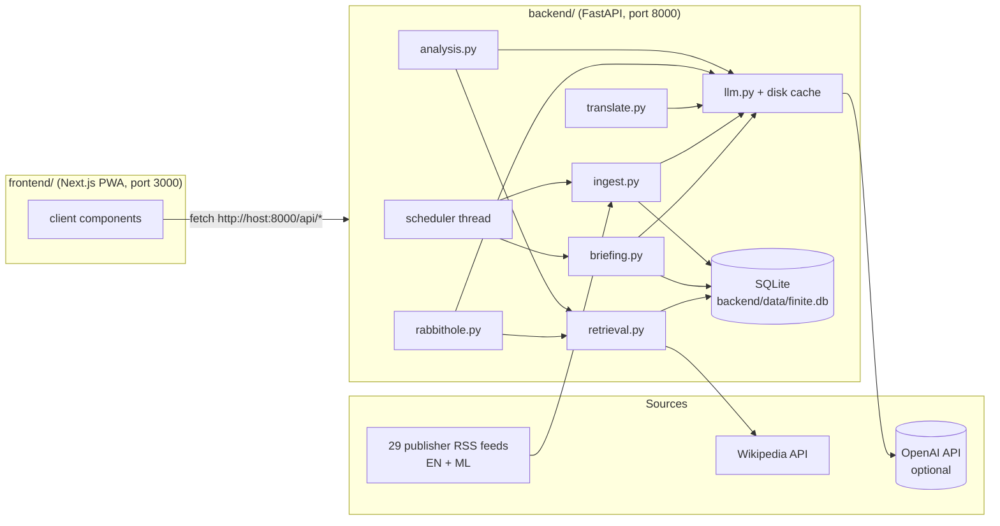

# PROJECT_CONTEXT.md — Finite

> **Canonical, agent-agnostic project memory.** Read this first, then verify against the code. If this document and the repository disagree, investigate the discrepancy; do not silently trust either. Maintenance rules: [AGENTS.md](AGENTS.md#persistent-project-context-and-documentation-maintenance) and [RULES.md](RULES.md#persistent-project-context-and-documentation-maintenance).
>
> **Last verified against repository:** 2026-10-25T04:39:05+05:30 on `main`, visual checkpoint `a9628be` plus the preference-controls commit containing this update. See the [Context Maintenance Log](#context-maintenance-log).

## Contents

- [0. One-minute overview](#0-one-minute-overview)
- [A. Project identity](#a-project-identity)
- [B. Product vision and requirements](#b-product-vision-and-requirements)
- [C. Feature inventory and implementation status](#c-feature-inventory-and-implementation-status)
- [D. System architecture](#d-system-architecture)
- [E. Technology stack](#e-technology-stack)
- [F. Repository structure and code navigation](#f-repository-structure-and-code-navigation)
- [G. Setup, execution, testing and deployment](#g-setup-execution-testing-and-deployment)
- [H. Design decisions and rationale](#h-design-decisions-and-rationale)
- [I. Current development state](#i-current-development-state)
- [J. Bugs, limitations and technical debt](#j-bugs-limitations-and-technical-debt)
- [K. Roadmap and pending tasks](#k-roadmap-and-pending-tasks)
- [L. Important historical context](#l-important-historical-context)
- [M. Instructions for incoming AI agents](#m-instructions-for-incoming-ai-agents)
- [Context Maintenance Log](#context-maintenance-log)

---

## 0. One-minute overview

**Finite** is a *finite*, personalised daily news briefing for Indian readers, in English and optionally Malayalam. Most news apps answer only *"What happened?"* and are designed for endless scrolling. Finite answers four questions:

1. What happened?
2. Why did it happen?
3. How did we get here?
4. What does it connect to?

It also **always ends**:

- **The briefing:** once a day, the user receives a frozen list of N stories, ranked by their weighted interests and a public source credibility index.
- **Rabbit holes:** any story can be opened into a "rabbit hole" that is cited and depth-limited. Level 0 is the event, Level 1 is context, Level 2 is connections, and then comes *Expedition complete*.
- **Knowledge Passport:** records what the user explored, with no streaks.

**Stack:**

- **Backend** (`backend/`): Python 3.13, FastAPI and SQLite. It reads RSS feeds, classifies and clusters articles, builds briefings, and generates cited explanations.
- **Frontend** (`frontend/`): a mobile-first Next.js 16 PWA.
- **OpenAI is optional.** Without `OPENAI_API_KEY` the app runs in *extractive mode*: it quotes source passages directly and uses no AI at runtime.

**Status:**

- **Verified without a key:** the MVP works end-to-end in extractive mode.
- **Live AI sample verified (25 Oct):** classification, embeddings, summaries, Missing Piece, Perspective Lens, two-level explorations, custom-question rejection and Malayalam rendering. See current state for limits.
- **Context:** built solo by Akash A, with Devin, at Devin Hacks Kochi (24–25 Oct 2026; code freeze 8:00 AM IST, 25 Oct).

---

## A. Project identity

| Item | Value |
| --- | --- |
| Name | **Finite**. Earlier working names were "CuriosityOS" and "signal50"; neither is used now. |
| Tagline | "News that ends. Understanding that doesn't." |
| Repository | https://github.com/akashanil-dev/Finite |
| Owner | Akash A ([@akashanil-dev](https://github.com/akashanil-dev)); solo participant |
| Context | Devin Hacks Kochi 2026 hackathon entry; intended to continue afterwards as a real product, including a mobile app |

**Vision.** A platform that turns current events into journeys of understanding. It combines (1) a personalised finite news briefing, (2) an interactive knowledge graph, and (3) an exploration engine driven by curiosity. The user decides how far down the rabbit hole to go, and every path has a visible end.

**Problem.** News apps optimise for engagement through infinite feeds and only report *what happened*. Readers who want to understand causes, history and connections must research on their own, or end up doomscrolling.

**Target audience.** Curious readers in India, initially English and Malayalam speakers (Kerala first, all India later), who want depth without compulsive consumption.

**Primary use cases.**

1. Read a short daily briefing at a chosen time and finish it.
2. Understand why a story happened, or how it came about, without leaving the app.
3. See what coverage left unexplained (the "Missing Piece").
4. Read Malayalam news, or read English news in Malayalam.
5. Look back at what you've learned over time.

**Expected user experience.** A colorful editorial dashboard (cream, charcoal, lime and pastel cards; serif reading headlines) with playful, calm motion that becomes an interactive map of knowledge as the user goes deeper. There are no streaks, no autoplay and no "recommended for you" loops.

**Differentiators.**

- **Finiteness:** the feed ends and the rabbit holes end.
- **Multiple dimensions of understanding:** a reader can choose origins, stakeholders, the dispute, place or next steps, instead of just "more articles".
- **Grounding:** every claim is cited and labelled established, reported or disputed.
- **Transparency:** the public source credibility index.
- **The Missing Piece.**
- **Malayalam support.**

**Definition of success (final product).**

- A user receives a correct, deduplicated briefing at their chosen time.
- Every generated claim is traceable to a source.
- Rabbit holes are useful and never fabricated.
- The experience ends cleanly.
- The product works on mobile, with a native app eventually.

---

## B. Product vision and requirements

Legend: **[M]** mandatory, approved by the owner · **[O]** optional enhancement · **[X]** exploratory idea, not approved.

### B1. User journey (five stages) [M]

1. **Define interests:** a two-level taxonomy of fields and subfields. Each selected subfield has a priority: occasional (1), moderate (2) or high (3). Users can exclude subjects and sources.
2. **Set the daily briefing:**
   - **Delivery:** periods are Morning, Noon, Evening and Night, and the user can also set an exact time and timezone.
   - **Lookback:** 24, 30 or **48 hours (default 30)**.
   - **Stories per briefing:** default 12.
   - **Default depth:** Quick (30s), Standard (2 min) or Deep (5 min).
3. **Receive a finite feed:**
   - The briefing is a fixed set of recent, source-backed stories, frozen when prepared, with no infinite scroll.
   - It is deduplicated against earlier briefings.
   - It shows both the original publish time and the latest update time.
4. **Open a rabbit hole:** causes, history, stakeholders, consequences and connections.
5. **Reach an ending:** finish the briefing, or save the journey to the Knowledge Passport. There are no further recommendations.

### B2. Functional requirements

| ID | Requirement | Class |
| --- | --- | --- |
| R1 | Two-level interest taxonomy with per-subfield priority weights | M |
| R2 | Exclude subjects and sources | M |
| R3 | Briefing prepared before delivery time, then **frozen** | M |
| R4 | 30h default lookback; dedupe against previous briefings | M |
| R5 | Finite feed with explicit ending; nothing more loads | M |
| R6 | Rabbit-hole questions are **generated for each story based on its type**, not hard-coded. The four core questions are common but not guaranteed. | M |
| R7 | Rabbit holes branch but have a fixed depth (`MAX_DEPTH = 2`) and a visible endpoint | M |
| R8 | Every rabbit-hole claim is cited. When sources are insufficient, say so instead of inventing an answer. | M |
| R9 | Users can ask their own question. It is scoped to the story, answered only from sources, uses up journey depth, and is rate-limited later. | M (owner left it to the agent; the agent recommended yes) |
| R10 | Language choice at onboarding. Choosing Malayalam crawls Malayalam outlets and enables Malayalam output. | M |
| R11 | Public, confidence-weighted index of every outlet and website used, for transparency | M |
| R12 | Perspective Lens: compare publisher coverage and group supported claims without false balance | M (implemented; live AI/browser sample verified) |
| R13 | Time Machine: a timeline of how an event developed | M (partly delivered via rabbit-hole timelines) |
| R14 | Connection Explorer: surprising, source-backed links *between* stories | O |
| R15 | Curiosity Challenges: the user predicts a connection before it is revealed (active learning, not trivia) | O |
| R16 | Knowledge Passport: map of explored concepts. **No streaks or pressure to return.** | M |
| R17 | Missing Piece: identify important questions the coverage didn't answer | M |
| R18 | Distinguish the article's original publish time from its update time | M |
| R19 | Native mobile app (Expo/React Native reusing the API) | X (owner wants it eventually; out of scope for the hackathon) |
| R20 | Regional languages beyond Malayalam (e.g. Hindi) | X |
| R21 | Push notifications when the briefing is ready | O |
| R22 | Multi-user accounts and authentication | O (required before any public launch) |

### B3. Non-functional requirements

- **Accuracy and grounding (top priority):** the LLM may only use retrieved passages. Claims are checked one by one, and unsupported claims are dropped.
- **Cost:** the owner has about **$50 of OpenAI credit**. Generation is per story, cached and shared by all users, never per user. Cheap models do bulk work and the stronger model is used only for rabbit-hole writing. Responses are cached on disk.
- **Neutrality:**
  - Credibility tiers are written down.
  - Claims are grouped by claim, not by outlet.
  - There are no left/right bias meters.
  - The methodology is published.
- **Legal and ethical content use:**
  - Show only short, original summaries with attribution and a link to the original.
  - Do not republish article text and do not bypass paywalls.
  - Respect robots.txt and rate limits.
  - **This remains a legal grey area, especially for AI processing. Get legal advice before a public launch.**
- **Mobile-first UI:** installable PWA, readable on phones, calm editorial style.
- **Accessibility:** **not yet assessed.** No audit has been done. Basic semantic HTML is used.
- **Performance:**
  - Briefing build is about 0.05s once articles are stored.
  - Ingesting all feeds takes about 4s.
  - Story analysis and rabbit holes take a few seconds in extractive mode; AI-mode latency has not been measured.
- **Security:**
  - Data APIs require cookie authentication; exact credentialed CORS and browser-write origin/header checks replace the former local-only open API.
  - Secrets live only in `backend/.env` (gitignored).

### B4. Design constraints (do not reverse without the owner's approval)

- The feed must stay **finite**. The owner's words: "it should be finite otherwise people won't use".
- No streaks or engagement pressure.
- Rabbit holes must stay depth-limited and end with "Expedition complete".
- Never present AI-generated text as fact without a citation.
- The app must keep working without an OpenAI key, in extractive mode, and must label which mode produced the content.

---

## C. Feature inventory and implementation status

Swipe briefing: finite vertical story deck with horizontal Brief / Different views / Explore panels, embedded two-level journeys and direction-aware dock. Native scrolling plus tabs/buttons/keyboard alternatives. Local desktop/mobile viewport validation passed; physical-device touch testing remains pending.

Status meanings:

- **COMPLETE:** implemented and verified.
- **IMPLEMENTED / UNVERIFIED:** code exists but hasn't been fully tested.
- **IN PROGRESS:** partially implemented.
- **PLANNED:** approved but not built.
- **PROPOSED:** discussed but not approved.
- **BLOCKED:** waiting on a dependency or decision.
- **DEPRECATED:** no longer part of the product.

Verification includes extractive checks on 24 Oct and a real-key AI sample/browser walkthrough on 25 Oct. 34 backend tests now exist. Live checks are sample coverage, not a full editorial audit.

| Feature | Description | Status | Relevant files | Remaining work |
| --- | --- | --- | --- | --- |
| Public landing page | Public product introduction, journey and feature cards; dedicated signup and login links | COMPLETE (local browser/build verified) | `frontend/src/app/page.tsx`, `signup/page.tsx`, `start/page.tsx`, `components/auth-form.tsx` | Live homepage verified; full accessibility audit pending |
| Visual system and motion | Responsive rail/dock, colored exploration panels, spring card lifts, gliding depth control, folding panels and completion flower | VERIFIED local browser sample | `frontend/src/app/globals.css`, `frontend/src/components/ui.tsx`, reader/briefing/login/Passport components | Physical-device, reduced-motion runtime and cross-browser audit pending |
| RSS ingestion | 29 feeds (English and Malayalam), language detection by script, upsert into SQLite | COMPLETE | `backend/app/ingest.py`, `backend/app/sources.py` | Add more Malayalam outlets; some publisher feeds block bots (see J) |
| Full-text extraction | Fetched lazily with trafilatura, cached in `articles.content` | COMPLETE | `backend/app/ingest.py` (`extract_article`) | None for the MVP |
| Keyword classification | Subfield and story-type scoring with phrase keywords plus source hints | COMPLETE (approximate quality) | `backend/app/ingest.py`, `backend/app/taxonomy.py` | Better quality; Malayalam articles default to `kerala` |
| LLM classification | Batches of 40 headlines sent to `FAST_MODEL` | VERIFIED live sample | `backend/app/ingest.py` (`llm_classify`) | Broader story coverage |
| Source credibility index | Tier, weight and rationale per outlet; public page | COMPLETE | `backend/app/sources.py`, `frontend/src/app/sources/page.tsx` | Weights are editorial (methodology v0) |
| Onboarding | Languages, explicit priority choices, exclusions, schedule | COMPLETE (live desktop verified) | `frontend/src/app/onboarding/page.tsx`, `frontend/src/components/profile-editor.tsx` | Manual walkthrough on a phone |
| Settings | Edit the same profile after onboarding | COMPLETE (live desktop verified) | `frontend/src/app/settings/page.tsx` | Manual walkthrough |
| Briefing builder | Lookback window, dedupe vs earlier briefings, clustering, weighted ranking, diversity cap, freeze | COMPLETE | `backend/app/briefing.py` | Clustering sometimes splits one event (see J) |
| Embedding clustering | Clusters by cosine similarity (0.8) when a key is set | VERIFIED live sample | `backend/app/briefing.py` (`_cluster`), `backend/app/llm.py` (`embed`) | Live sample passed; broaden coverage |
| Saved briefing APIs | Owned paginated history, immutable editions, one extra attempt per original, no chaining | VERIFIED backend tests | `backend/app/briefing.py`, `main.py`, `db.py` | Production verification pending |
| Scheduler | Ingests every 60 min; freezes the briefing 30 min before delivery time | IMPLEMENTED / UNVERIFIED (never seen firing at a real delivery time) | `backend/app/main.py` (`scheduler`) | Observe one real trigger |
| Story analysis (extractive) | Lead-sentence summaries at 3 depths, cited facts, template questions and Missing Piece | COMPLETE | `backend/app/analysis.py` | Missing Piece is generic without a key |
| Story analysis (AI) | Summaries, facts, story type, Missing Piece, 4–6 tailored questions, concepts | VERIFIED live sample | `backend/app/analysis.py` (`ANALYSIS_SYSTEM`) | Sample passed; broader grounding quality review |
| Missing Piece | What the coverage didn't explain; each item opens a rabbit hole | VERIFIED live sample | `backend/app/analysis.py`, story page | AI browser sample passed; broader coverage pending |
| Rabbit holes (extractive) | Passages from articles and Wikipedia, ranked by TF-IDF; nodes, timeline, follow-ups | COMPLETE | `backend/app/rabbithole.py`, `backend/app/retrieval.py` | Follow-up questions can be odd, e.g. "How does Heinlein connect…" |
| Rabbit holes (AI) | `SMART_MODEL` writes only from passages, then `FAST_MODEL` checks each claim; uncited or unsupported claims dropped | VERIFIED live sample | `backend/app/rabbithole.py` | Live sample passed; broaden coverage |
| Depth limit and ending | `MAX_DEPTH = 2`, journey map, "Expedition complete", end at any point | VERIFIED live sample | `backend/app/config.py`, `rabbit-hole.tsx` | Broader coverage |
| Ask your own question | Free-text question scoped to the story; off-topic check (word overlap without a key, LLM with one) | VERIFIED live sample | `backend/app/rabbithole.py`, story page | Rate limiting; matching similar questions to a cached answer |
| Time Machine | Dedicated source-extractive story timeline and separate coverage history; rabbit-hole timelines retained | COMPLETE (v1; desktop browser verified) | `time_machine.py`, `time-machine.tsx`, story page | English date patterns; broader archive and semantic date interpretation deferred |
| Malayalam translation | Translates generated content; cached per story | Rendering verified; human quality review pending | `backend/app/translate.py` | Live rendering passed; owner to judge quality |
| Malayalam crawl | Choosing Malayalam adds Malayalam feeds to briefings | COMPLETE | `backend/app/sources.py`, `backend/app/briefing.py` | Malayalam stories rank low without a key |
| Knowledge Passport | Saved journeys, concept cloud, fields explored, counts | VERIFIED live sample | `backend/app/main.py`, Passport page | Broader coverage |
| Citations UI | Citation chips with popovers (source, weight, link); confidence badges | COMPLETE (live desktop sample verified) | `frontend/src/components/citations.tsx` | Manual walkthrough |
| PWA manifest | Installable app manifest and icon | IMPLEMENTED / UNVERIFIED | `frontend/src/app/manifest.ts`, `frontend/public/icon.svg` | No service worker or offline support |
| Perspective Lens | On-demand original coverage comparison; AI groups cited claims with fail-closed verification | IMPLEMENTED / PARTIALLY VERIFIED | `backend/app/perspectives.py`, `frontend/src/components/perspective-lens.tsx` | Seven backend/API tests, desktop/mobile browser QA and production build pass; real-key sample passed; broader quality review pending |
| Curiosity Challenges | Optional three-hypothesis prediction before Level 2; reveal, skip, reflect and save | COMPLETE in extractive mode | `curiosity-challenge.tsx`, `rabbit-hole.tsx`, Passport | Desktop/mobile browser QA passed; live AI journey/Passport sample passed; no extra AI generation |
| Connection Explorer | Three finite source-backed cross-story comparisons | COMPLETE (v1; desktop browser verified) | `connections.py`, `connection-explorer.tsx` | Conservative subject + headline-context matching; no causal inference |
| Interactive knowledge graph | Selectable source-backed story map with list alternative | COMPLETE (v1; desktop browser verified) | `connection-explorer.tsx` | Literal shared mentions only; maximum three branches |
| Push notifications | "Briefing ready" alert | PROPOSED | — | — |
| Accounts and auth | Username/password, cookie sessions and per-user profiles/briefings/Passport | COMPLETE (local API and live desktop verified) | `auth.py`, `db.py`, `main.py`, login, auth gate | Live HTTPS auth/isolation verified; broader security/UX review pending; no reset |
| Native mobile app | Expo app reusing the API | PROPOSED (owner wants it after the hackathon) | — | — |

---

AI budget guard: configurable conservative reservation allowance (default $1, dev $5, production $15; maximum $15) in `backend/data/ai_budget.sqlite3`; atomic across local workers, no refunds/reset, 100 requests maximum, reviewed models only. Four guard tests and backend import pass; live testing follows. `GET /api/ai-budget` exposes reservations, not billing.

## D. System architecture

Saved-edition storage adds `refresh_used`, `edition_of`, and `scheduled_for` to briefings, a unique user/delivery-date index, and a first-creation request claim table. Owned history uses cursor pagination; extra-edition claims commit before ingestion. Existing rows and progress are retained.

Public entry routes are `/`, `/login` and `/signup`. `/start` preserves the previous profile-based redirect to onboarding/briefing after authentication. The landing page performs no API calls. Backend authorization is unchanged.


Deployment target: two ARM64 containers (Node standalone frontend and single-worker FastAPI backend), shared existing Caddy TLS proxy via external finite-edge network. No app ports published. `/opt/finite/data` persists all SQLite/cache/budget state. GitHub builds immutable SHA tags; deployment requires repository enable variable and repository Actions secrets. Forced-command SSH invokes root-owned scripts/configuration. Oracle deployment and public HTTPS are verified; see `deploy/README.md`.

Accounts add `users`, `sessions`, `auth_attempts` and nullable `user_id` ownership columns on briefings/journeys. Profiles use `kv.profile:<id>`. Legacy rows remain unassigned. Story/source caches are shared. API auth is a global dependency; only health and registration/login bypass it. Local CLI commands claim legacy data or grant/revoke admin. Scheduler is configurable and builds per-user briefings; it still requires a single backend worker.

Knowledge graph: client-only view of the existing connections endpoint. At most three selectable nodes reveal stored citations; no new endpoint, schema or provider calls.

Connection Explorer: GET `/api/stories/{id}/connections` revalidates saved concepts and derives headline entities from stored articles; requires subject mentions in both headlines and two additional non-stopword context terms. Ranks the latest 200 candidates by context overlap before choosing up to three cited comparisons. Profile exclusions/languages and overlapping articles/URLs are filtered. No schema changes or AI calls.

### D1. High level



### D2. Briefing and exploration data flow

```mermaid
sequenceDiagram
  participant U as User (PWA)
  participant API as FastAPI
  participant DB as SQLite
  U->>API: PUT /api/profile (interests, schedule, langs)
  U->>API: POST /api/briefings (ingest + build)
  API->>DB: articles in lookback window, minus already-briefed
  API->>API: relevance x source weight x recency -> cluster -> coverage bonus -> diversity cap
  API->>DB: insert stories + frozen briefing
  API-->>U: briefing (stories); background prefetch of analysis
  U->>API: GET /api/stories/{id}?lang=
  API->>API: analyze() (cached in stories.analysis)
  U->>API: POST /api/stories/{id}/explore {question, depth}
  API->>API: gather passages (articles + Wikipedia) -> synth (AI) or extractive -> verify
  API->>DB: cache in explorations (shared by all users)
  U->>API: POST /api/journeys -> GET /api/passport
```

### D3. Backend

Time Machine: `GET /api/stories/{id}/timeline` reads stored article content/descriptions without network or LLM calls. It returns a finite cited event list, unresolved dates and separate publication/update history. No schema change.


All OpenAI requests pass through the persistent budget reservation guard. SDK retries are disabled. Timeline and node verification fail closed. Extractive story caches can upgrade to AI when a key is present.


- **Entry point:** `backend/app/main.py`, served by `uvicorn app.main:app`. The lifespan hook calls `db.init()` and starts a daemon `scheduler()` thread. A `ThreadPoolExecutor(4)` prefetches story analysis after each briefing is built. A non-blocking lock (`_ingest_lock`) prevents ingests from running at the same time.
- **Ranking** (`briefing.py`):
  - Per article: `score = relevance × (0.5 + 0.5 × source_weight) × exp(−hours/26)`.
  - Relevance is the user's priority weight times classification confidence. Priority weights are 1.0 for high, 0.6 for moderate and 0.3 for occasional.
  - Clustering is greedy, by cosine similarity: TF-IDF at threshold 0.32, or embeddings at 0.8 when a key is set.
  - Per cluster: the score is multiplied by `1 + 0.3·log2(#sources)`, and by 0.6 if the cluster comes only from aggregators.
  - Diversity cap: at most `ceil(n/4)` stories (minimum 2) per lead subfield.
  - A cluster is dropped if more than half its articles appeared in earlier briefings.
- **Grounding** (`retrieval.py`): passages are labelled `A{article}.{chunk}` for news and `W{page}.{chunk}` for Wikipedia background, then ranked by TF-IDF against the question. The top 10 go to the model.
- **AI pipeline:**
  - `analysis.analyze` uses `FAST_MODEL`.
  - `rabbithole.explore` uses `SMART_MODEL` for writing, then `_verify` uses `FAST_MODEL` to check claims.
  - Citations not found among the retrieved passages are removed, and nodes left without citations are dropped.
- **Caching:**
  - `stories.analysis`: once per story, permanently.
  - `stories.translations`: per language.
  - `explorations`: keyed by version, story/question, depth, angle, search and custom-question flag and shared by everyone.
  - `backend/data/llm_cache/*.json`: each response stored under a hash of its exact prompt.
  - An in-memory cache for Wikipedia lookups.
- **Error handling:**
  - LLM failures are logged and return `None`, so callers fall back to extractive output.
  - Feed and extraction failures are logged and skipped.
  - API errors are returned as `HTTPException` with a `detail` message.
- **Logging:** Python `logging` at INFO, to stdout. There is no metrics or tracing setup.

### D4. Database (SQLite, `backend/app/db.py`)

Startup uses idempotent additive migrations for accounts and ownership columns, preserving legacy data. Back up before schema changes; do not delete the database or budget ledger. A general migration framework remains future work.

| Table | Key columns | Notes |
| --- | --- | --- |
| `articles` | `id` (hash of URL), `source_id`, `lang`, `title`, `url`, `description`, `content`, `published_at`, `updated_at`, `subfields` (JSON), `story_type`, `classified` (0 = no, 1 = keyword, 2 = LLM) | Upserted on each ingest |
| `stories` | `id` (`s` + hash of sorted article ids), `article_ids` (JSON), `title`, `lang`, `subfields`, `story_type`, `analysis` (JSON), `translations` (JSON) | A cluster of articles |
| `briefings` | `id`, `user_id`, `created_at`, `window_start/end`, `config` (snapshot of the profile), `story_ids`, `read_ids`, `completed_at` | Frozen once built |
| `explorations` | `key`, `story_id`, `payload` (JSON) | Shared cache of rabbit-hole steps |
| `journeys` | `user_id`, `story_id`, `story_title`, `path`, `concepts` | Knowledge Passport entries |
| `users` | `id`, `username`, `password_hash`, `is_admin`, `created_at` | Registered accounts; admin is local-only explicit grant |
| `sessions` | `token_hash`, `user_id`, `expires_at` | Revocable cookie sessions |
| `auth_attempts` | `key`, `started_at`, `attempts` | Persistent login rate buckets |
| `kv` | `key`, `value` | Holds `profile:<user_id>`, preserved legacy `profile`, and shared `last_ingest` |

### D5. API (JSON; local port 8000, production same-origin `/api`)

Auth: POST `/api/auth/register`, `/api/auth/login`, `/api/auth/logout`; GET `/api/auth/me`. GET `/api/health` is public. Other endpoints require a session; ingestion/budget administration requires local admin grant.

| Method and path | Purpose |
| --- | --- |
| `GET /api/meta` | App name, `mock_mode`, models, `max_depth`, taxonomy, languages, delivery periods, depths, last ingest |
| `GET /api/sources` | Credibility index, tiers, methodology |
| `GET / PUT /api/profile` | Read or save the authenticated user profile (validated by ProfileBody and `briefing.save_profile`) |
| `POST /api/ingest` | Run ingestion now |
| `POST /api/briefings?refresh=true` | Ingest if `refresh`, then build and freeze a briefing. Returns 404 if no stories match. |
| `GET /api/briefings/latest`, `GET /api/briefings/{id}` | Briefing payload with story cards |
| `POST /api/briefings/{id}/read` `{story_id}` | Mark a story read; sets `completed_at` once all are read |
| `GET /api/stories/{id}?lang=en\|ml` | Story card plus analysis (translated if `ml`) |
| `POST /api/stories/{id}/explore` `{question, angle, search[], depth, custom, path[], lang}` | One rabbit-hole step |
| `POST /api/journeys` `{story_id, path[], concepts[]}` | Save to the Passport |
| `GET /api/passport` | Journeys, concepts, areas, counts |

### D6. Frontend

- **Framework:** Next.js 16 App Router with **Cache Components and Partial Prefetching enabled** (`frontend/next.config.ts`).
- **Data fetching:** every screen is a **client component** that fetches from the API using `useApi` (`frontend/src/lib/hooks.ts`). There are no server-side data fetches.
- **API base URL:** `NEXT_PUBLIC_API_URL` if set, otherwise `${location.protocol}//${location.hostname}:8000`. This lets a phone on the same Wi-Fi reach the laptop's backend. Requests are not proxied through Next, because LLM calls can be slow.
- **Dynamic route:** `/story/[id]`. `page.tsx` is a server component that wraps `story-view.tsx` in `<Suspense>`. This is required because `useParams`, `useSearchParams` and `usePathname` suspend under Cache Components.
- **Lint constraint:** the react-hooks lint rule `set-state-in-effect` is active. Avoid calling setState synchronously inside effects; derive state, or set it from promise callbacks.
- **Styling:** Tailwind v4 theme tokens in `frontend/src/app/globals.css` (`paper`, `card`, `ink`, `accent` and others). Fonts are Inter, Newsreader and Noto Sans Malayalam.

### D7. Perspective Lens

`GET /api/stories/{story_id}/perspectives` is fetched only when the panel opens. It reads stored cluster articles, keeps one per publisher homepage hostname, excludes aggregators, and compares up to eight publishers. It does not fetch more article text. Headlines and excerpts are always available; optional English AI claims require valid citations and explicit approval from a separate verifier. Missing or malformed verdicts fail closed to excerpts. Corroboration means agreement within supplied coverage, not independent proof. Existing LLM disk caching includes exact evidence and prompts; no schema changes. Original excerpts are not translated.

### D8. Curiosity Challenges

A client-side optional three-choice prediction precedes the existing Level 2 explore request. Choices are hypotheses (shared history, similar mechanism, wider impact), not scored claims. Reveal/skip makes the normal request; cancel makes none. The prediction is kept through retries, shown beside Level 2, and saved as an optional `prediction` string in the existing journey path JSON. Passport displays it. No schema change or added AI call. Challenge heading receives keyboard focus. Save failures show a retry action and preserve the prediction; saving disables repeat clicks. Exploration cache v2 includes depth and retrieval inputs to preserve the final endpoint.

### D9. Auth, deployment and observability

- **Auth:** username/password; salted scrypt, hashed opaque session tokens, HttpOnly/SameSite=Lax cookies (Secure on HTTPS). Data APIs require sessions; explicit ownership filters protect personal records. CORS allows configured origins only; write requests require a custom header and valid Origin when present.
- **Deployment:** Oracle ARM64 frontend/backend containers behind existing Caddy at https://finite.akashanil.dev. Main pushes automatically build, test, publish and deploy over restricted SSH; protected server configuration requires separate approved updates.
- **Observability:** stdout logs only.

---

## E. Technology stack

| Layer | Technology (version from manifests) | Rationale (as decided in-session) |
| --- | --- | --- |
| Backend language | Python 3.13 (`backend/.python-version`), uv 0.12 | Best ecosystem for scraping and extraction (feedparser, trafilatura) and ML utilities |
| API | FastAPI ≥0.162, Uvicorn ≥0.54 | Simple async API; Rationale not documented beyond simplicity |
| Storage | SQLite (stdlib `sqlite3`, WAL mode) | Simplest option for the hackathon; planned move to Postgres + pgvector later |
| Feeds and extraction | feedparser ≥6.0.14, trafilatura ≥2.3.1, httpx ≥0.28 | trafilatura handles Malayalam pages; Playwright was considered only for sites that need JavaScript (not used) |
| ML utilities | scikit-learn ≥1.9 (TF-IDF), NumPy ≥2.5 | Clustering and passage ranking without a key |
| LLM | OpenAI Python SDK ≥3.37, Responses API with `json_object` format | The owner has $50 of OpenAI credit |
| Models | `gpt-6-luna` (fast, cheap), `gpt-6.1-sol` (rabbit-hole writing), `text-embedding-3-small` | Chosen from the OpenAI pricing page on 2026-10-24 (luna $0.10/$0.50, sol $2/$10, embeddings $0.02 per 1M tokens). Overridable via env vars. |
| Frontend | Next.js 16.4.3, React 19.3.0, TypeScript 5, Tailwind CSS 4, ESLint 9 (`eslint-config-next`) | Mobile-first PWA; quickest way to demo on a phone; the API is reusable by a future native app |
| Node | Node 20+ required (dev machine: v26.7.0), npm | — |
| Background data | Wikipedia (MediaWiki API, CC BY-SA) | Open background source for history and context |
| Tests | Python unittest (seven Perspective Lens tests plus two depth-cache/journey tests) | Fixtures and API routing; no live AI calls |
| Hosting | **None** (local demo) | — |

---

## F. Repository structure and code navigation

```
.
├── PROJECT_CONTEXT.md        ← this file (canonical project memory)
├── AGENTS.md                 ← agent workflow rules + project commands
├── RULES.md                  ← event rules (Devin Hacks Kochi) + context-maintenance rules
├── README.md                 ← human-facing overview, setup, status
├── CHANGELOG.md              ← timestamped dev log (update with every meaningful change)
├── AI_USAGE.md               ← record of AI tool contributions
├── SUBMISSION.md             ← hackathon submission details/checklist
├── .github/pull_request_template.md
├── .gitignore                ← ignores .env, node_modules, .venv, .next, backend/data/, …
├── backend/
│   ├── pyproject.toml, uv.lock, .python-version, .env.example
│   ├── data/                 ← runtime state (gitignored): finite.db, llm_cache/
│   └── app/
│       ├── main.py           ← FastAPI app, routes, scheduler, prefetch pool  (ENTRY POINT)
│       ├── config.py         ← env vars, paths, models, MAX_DEPTH, MOCK_MODE
│       ├── db.py             ← SQLite schema, connection helpers, kv store
│       ├── taxonomy.py       ← FIELDS/SUBFIELDS (+ keyword hints), STORY_TYPES
│       ├── sources.py        ← SOURCES credibility index, TIERS, methodology text
│       ├── ingest.py         ← feed fetch, lang detect, keyword/LLM classify, extract_article
│       ├── briefing.py       ← profile defaults/validation, build_briefing, payloads, mark_read
│       ├── retrieval.py      ← story articles, Wikipedia search, passage ranking (gather)
│       ├── analysis.py       ← ANGLES/TYPE_ANGLES, Missing Piece templates, analyze()
│       ├── rabbithole.py     ← explore(): synth prompt, verification, extractive fallback, cache
│       ├── translate.py      ← Malayalam translation of payload string leaves
│       ├── llm.py            ← chat_json(), embed(), disk cache, mock-mode None
│       └── textutil.py       ← hashing, HTML cleaning, lang detection, sentence/chunk utils
└── frontend/
    ├── package.json, next.config.ts, tsconfig.json, eslint.config.mjs
    ├── AGENTS.md             ← Next.js-managed note: read node_modules/next/dist/docs first
    ├── public/icon.svg
    └── src/
        ├── lib/api.ts        ← API types, api() fetch helper, base URL, formatters
        ├── lib/hooks.ts      ← useApi() hook
        ├── components/ui.tsx           ← Shell (bottom nav), Button, badges, Skeleton, ErrorNote
        ├── components/profile-editor.tsx ← LanguagePicker, InterestPicker, Exclusions, ScheduleForm
        ├── components/rabbit-hole.tsx  ← RabbitHole, JourneyMap, StepView
        ├── components/citations.tsx    ← CitationChips, ConfidenceBadge
        └── app/
            ├── layout.tsx, globals.css, manifest.ts, favicon.ico
            ├── page.tsx                ← redirects to /onboarding or /briefing
            ├── onboarding/page.tsx     ← intro + 4-step wizard
            ├── settings/page.tsx       ← tabbed profile editor
            ├── briefing/page.tsx       ← finite feed + ending
            ├── story/[id]/page.tsx     ← Suspense wrapper
            ├── story/[id]/story-view.tsx ← story, Missing Piece, questions, ask-your-own, rabbit hole
            ├── passport/page.tsx       ← Knowledge Passport
            └── sources/page.tsx        ← credibility index
```

**Where to change things:**

| To change… | Edit… |
| --- | --- |
| Outlets or weights | `backend/app/sources.py` |
| Interest categories or keywords | `backend/app/taxonomy.py` |
| Ranking | `backend/app/briefing.py` |
| Prompts | `ANALYSIS_SYSTEM` in `analysis.py`; `SYNTH_SYSTEM` and `VERIFY_SYSTEM` in `rabbithole.py`; `SYSTEM` in `translate.py`; `LLM_CLASSIFY_SYSTEM` in `ingest.py` |
| Depth limit | `MAX_DEPTH` in `config.py` |
| Theme | `frontend/src/app/globals.css` |

**Tests:** `backend/tests/test_perspectives.py` covers Perspective Lens and its API route; `test_exploration_depth.py` covers depth-safe caching and saved predictions.

---

## G. Setup, execution, testing and deployment

**Prerequisites:** Python 3.13 with uv; Node.js 20+ with npm; internet access (feeds and Wikipedia).

```bash
# 1. Backend (verified 2026-10-24)
cd backend
uv sync
cp .env.example .env          # optional; set OPENAI_API_KEY to enable AI mode
uv run uvicorn app.main:app --host 0.0.0.0 --port 8000

# 2. Frontend (verified 2026-10-24), second terminal
cd frontend
npm install
npm run dev -- -H 0.0.0.0 -p 3000
# open http://localhost:3000  (phone on same Wi-Fi: http://<laptop-ip>:3000)
```

**Environment variables** (names only, never commit values; `backend/.env` is gitignored):

| Variable | Where | Purpose | Default |
| --- | --- | --- | --- |
| `OPENAI_API_KEY` | backend | Enables AI mode. If empty, `MOCK_MODE = True` (extractive mode). | empty |
| `FINITE_FAST_MODEL` | backend | Classification, analysis, verification, translation | `gpt-6-luna` |
| `FINITE_SMART_MODEL` | backend | Rabbit-hole writing | `gpt-6.1-sol` |
| `FINITE_EMBED_MODEL` | backend | Clustering embeddings | `text-embedding-3-small` |
| `FINITE_INGEST_INTERVAL_MIN` | backend | Scheduler ingest interval | `60` |
| `NEXT_PUBLIC_API_URL` | frontend | Override the API base URL | `<same host>:8000` |

**Checks** (all passed on 2026-10-24 at `6612103`; no application code has changed since):

```bash
cd frontend && npx tsc --noEmit && npx eslint src && npx next build
cd backend && uv run python -c "import app.main"
```

Perspective Lens now has a focused unittest suite (`uv run python -m unittest discover -s tests -v`). Broader API coverage remains pending. The historical API smoke test used was:

- `PUT /api/profile`
- `POST /api/briefings?refresh=false`
- `GET /api/stories/{id}`
- `POST /api/stories/{id}/explore`
- `POST /api/briefings/{id}/read`
- `POST /api/journeys`

**Production build:** `cd frontend && npx next build && npm start`. Verified to build; `npm start` has not been verified. Deployment is not configured.

**Resetting state:** delete `backend/data/finite.db` to clear everything; the schema is recreated on startup. Clearing only the profile and briefings via SQL also works (see `db.kv_set` and `db.tx`). Do this only with the owner's consent if the data matters.

**Troubleshooting:**

| Symptom | Cause / fix |
| --- | --- |
| UI shows "Can't reach the Finite API" | Backend isn't running on port 8000, or the phone can't reach the laptop's IP. Set `NEXT_PUBLIC_API_URL`. |
| `POST /api/briefings` returns 404 "No stories matched" | No interests selected, or nothing in the lookback window. Widen the lookback or add interests. |
| Build error "blocking-prerender … client hook" | A URL hook (`useParams`/`useSearchParams`/`usePathname`) or `new Date()` was rendered outside `<Suspense>`. See D6. |
| Lint error `set-state-in-effect` | Move setState into a promise callback or derive the value (see `useApi`). |
| Malayalam shows "translation unavailable" | No `OPENAI_API_KEY`; expected in extractive mode. |

---

## H. Design decisions and rationale

2026-10-25 — Preserve every briefing. Each original/scheduled edition gets one extra-edition attempt; generated extras cannot chain. An empty/failed attempt stays consumed, as requested for one press. Scheduling is keyed by local delivery date, not the last manual refresh.

2026-10-25: Owner requested Instagram-like vertical news navigation and sideways in-card features, while retaining a finite endpoint. Long source content scrolls within its panel; Previous/Next provides direct story navigation. Motion remains calm and playful. Cards fetch on first visit and retain state until the page is left.

- Knowledge-map precision takes precedence over filling three branches. Cached concepts are revalidated at request time; weak results remain empty. Headlines provide salience and independent context; recency only bounds the candidate pool.


- Public homepage stays available to visitors and signed-in readers; account entry is explicitly `/start`. Landing visuals are illustrative journey cards, not fabricated live news.


2026-10-25T04:38:33+05:30 — Owner approved the Pinterest-informed overhaul and clarified that “smooth” means enjoyable, playful and calm animation. CSS transitions/keyframes and a small shared Fold/Segmented/CompletionFlower set implement that direction without a new dependency. Opened exploration panels retain fetched data for their mounted lifetime; closing does not trigger another request. Reading position is restored when leaving an in-page rabbit hole.

D28 — Owner now requests automatic deployment on main pushes after CI, superseding D27 only for routine workflow releases. Forced-command SSH with root-owned deployment code/configuration is prepared; general-command key installation was rejected by automatic approval review. Owner approved protected installation, secrets and enablement; these are installed and the restricted-key deployment passed. Push-triggered end-to-end verification remains pending.

D27 — Owner requires independent live verification of containerized Caddy and explicit approval before every server change or precisely scoped batch, including deployment, rollback, data-writing tests and documentation/Git mutations. Read-only discovery comes first; setup instructions are not authorization. See `deploy/SERVER_HANDOFF.md`.

D26 — Reuse the existing Oracle host/Caddy entry point from Tuxos, but package Finite as separate ARM64 containers. Keep API same-origin, data outside images, scheduler off initially, and deployment gated until server setup. Pin uv to the locally used version for lockfile compatibility.

D25 — Username/password accounts with simple 8-character minimum, no reset/email flow. Opaque revocable cookie sessions; use scrypt from the standard library. Do not give legacy data or admin rights to the first registrant. Preserve unowned history for explicit owner migration.

D24 — Use a finite responsive tree map with native buttons and a list alternative, rather than a free-panning canvas. Nodes reveal evidence without fetching or recursive expansion.

D23 — Connection Explorer uses cited shared mentions from stored coverage, with inline comparisons and a three-result ending. This avoids unsupported causal claims, recursive story recommendations and new API spending.

| # | Decision | Why | Alternatives / trade-offs | Status |
| --- | --- | --- | --- | --- |
| D1 | **The feed is finite**, with an explicit ending | The core product idea; the owner insists | An infinite feed would retain users better but contradicts the product | Active, non-negotiable |
| D2 | Rabbit holes have **two levels** (context, then connections) and then end | Curiosity without compulsive consumption | Deeper graphs would cost more and risk endlessness | Active |
| D3 | **Retrieve sources first, then write.** Every claim is cited, then checked; uncited or unsupported claims are dropped; "insufficient" is an allowed answer. | Hallucination is the biggest risk to a product built on sources | Writing from the model's own knowledge is cheaper but untrustworthy | Active |
| D4 | **Generate per story and share** (analysis and explorations cached for everyone) | Keeps cost tied to the number of stories, not users ($50 budget) | Personalised generation costs more | Active |
| D5 | Use models in tiers (luna for bulk, sol for rabbit-hole writing); cache LLM responses on disk | Cost | — | Active |
| D6 | **Extractive fallback without a key**, labelled in the UI | Works with no key and supports a no-cost demo | Lower quality without a key | Active |
| D7 | Questions are **chosen per story type** (`TYPE_ANGLES`, or tailored by the LLM), not fixed | Owner: the questions "are not fixed… based on the type of news" | — | Active |
| D8 | Missing Piece findings feed the rabbit-hole questions | One pipeline serves both features | — | Active |
| D9 | Ask-your-own allowed, but scoped to the story, answered only from sources, and lower on the page than suggested questions | Prevents it turning into a general chatbot and controls cost | — | Active (rate limiting not built) |
| D10 | Content: RSS first, then extraction for internal processing only; show own short summaries plus a link; no paywall bypass | Legal and ethical; the owner approved scraping where needed | Republishing full text is legally risky | Active; get legal review before launch |
| D11 | Public **source credibility index** (tier, weight, rationale); claims grouped by claim, not outlet; no bias meters | Transparency and neutrality (owner's idea plus agent's suggestion) | Left/right bias meters are contested in India | Active; weights are v0 editorial judgements |
| D12 | **30h default lookback** plus dedupe | 6h overlap so late stories aren't missed | 24h could miss stories; 48h brings in stale ones | Active |
| D13 | Freeze the briefing 30 min before delivery time | A stable reading experience | — | Active |
| D14 | Mobile-first **PWA** for the hackathon, with a separate API | Fast to demo on phones; the API can be reused by a future Expo app | An Expo app is slower to build tonight | Active |
| D15 | Next.js client components plus direct browser→API calls (no proxy) | Avoids proxy timeouts on slow LLM calls; simpler with Cache Components | Server components with caching | Active |
| D16 | Original single-user SQLite model | Hackathon speed | Superseded by additive user/session/ownership migration; Postgres remains optional future work | Superseded for auth |
| D17 | India first; Malayalam is the first regional language; Malayalam outlets are crawled only if chosen | Owner's market choice; Kochi audience | — | Active |
| D19 | Perspective Lens uses existing excerpts and fails closed on verification failure | Avoid extra scraping and unchecked comparison claims | Coverage and AI quality remain limited; hostname deduplication cannot detect syndication | Active |
| D20 | Ungraded connection hypotheses with skip and source-based reflection | Active learning without invented answers or scores; no extra AI calls | Generic choices rather than generated quizzes | Active |
| D22 | Time Machine uses complete dated source quotations; publication timestamps stay separate | Preserve remaining AI allowance and avoid invented chronology | English patterns can miss dates; no complete archive | Active |
| D21 | Configurable persistent conservative reservation guard (dev $5; production $15), no automatic refunds or resets | Owner-approved testing allowance; reserve before calls, including failed calls | Installation-local only; not an account billing cap | Active |
| D18 | Name **"Finite"** | Owner's choice from the suggestions | Warren, Undercurrent, Kaaranam, Fathom, Sutra were considered | Active |

---

## I. Current development state

2026-10-25T06:43:15+05:30 — Saved-edition APIs and additive migration implemented; 51 backend tests pass, covering ownership, pagination, duplicate/concurrent refresh, empty attempts, no chaining, and midnight schedule preparation. Production scheduling remains disabled.

2026-10-25T06:24:38+05:30 — Release `b33eb6e` (AI fix `538f9f6`) deployed via successful full Actions run `40148109626`. Owner explicitly approved production AI activation: server-only key, separate $15 allowance, scheduling disabled, backend healthy. Root-only environment backup `/var/backups/finite-ai-20261025T005142Z`. Actual production Kerala article `se042c3c12ba6000d` regenerated relevant AI summaries/questions in the browser. Development reservations $2.281297 of $5 (57 requests); production Kerala rabbit-hole sample completed with three cited relevant nodes and inspectable source links ($0.246894 reserved, $14.753106 remaining, 4 requests).

2026-10-25T06:14:39+05:30 — AI reliability fixes: analysis v3 independently checks summaries, claims, questions and missing-piece premises; failed summaries become source excerpts. Rabbit-hole fallbacks no longer fabricate entity-based follow-ups, mark incomplete evidence, and upgrade when AI is available. Translation caches track analysis version/mode. 43 backend tests pass; real API sample audit covers Kerala and Jamia, two depths, off-topic rejection, translation, classification, embeddings and multi-outlet comparison. Production AI was subsequently explicitly approved and activated at $15; scheduler remains disabled. Swipe UX is implemented and locally browser-verified; see AI_UX_QA.md.

2026-10-25T05:47:36+05:30 — Knowledge-map false-positive fix: 39 backend tests passed; published Kerala report with synthetic comparison fixtures and 20 stored stories checked locally. No AI spend. Release `584716f` deployed; Actions run `40146140933` passed checks, builds, smoke tests and public verification.


2026-10-25T05:25:18+05:30 — Public landing page implemented and locally verified at desktop/320px. Signup/login links and section navigation work; tsc, ESLint and production build pass. Release `b7ed394` deployed successfully via Actions run `40144672691`; live public homepage and signed-out `/start` redirect verified. No API spend.


2026-10-25T04:43:14+05:30 — Redesign release `f64b943` is live: Actions 40141543544 passed all jobs, including deploy. Live HTTPS login visually verified. Local production-preview authenticated QA passed; full verification scope is in DESIGN_QA.md. No new AI usage.

2026-10-25T04:39:05+05:30 — Visual system checkpoint `a9628be`; preference controls and narrow-screen corrections follow in this commit. Explicit priority selection, saved value persistence and 320px overflow checks passed in the local production preview.

2026-10-25T04:38:33+05:30 — Visual overhaul implemented and locally exercised with AI disabled and an isolated database. Desktop (1280/1440) and mobile (390) samples cover signup/onboarding, briefing, depth selection, Lens, graph/list/evidence, timeline, challenge, completion and Passport save. Production build passes. Production release verification follows push.

2026-10-25T04:05:26+05:30 — Live QA fixes deployed and verified at `5613245` through Actions run 40138920728. Both containers healthy, current-state database backups pass integrity, account writes work after deployment, and AI spending remains zero. LIVE_QA.md records browser acceptance and untested AI/mobile/scheduler boundaries.

2026-10-25T04:01:18+05:30 — Production browser QA completed for signup/login/logout/isolation, onboarding, preferences, 12-story completion/regeneration, citations, single-publisher lens, connections/graph/list, Time Machine, rabbit holes/challenge/Passport and off-topic rejection. See LIVE_QA.md for exact boundaries. Backup ownership, silent errors, inverted exclusions and conditional schedule wording fixed. No API spending.

2026-10-25T03:52:41+05:30 — Live signup found host-backup-created WAL/SHM ownership blocking SQLite writes. Approved ownership repair restored signup; protected deployment script now performs online backups inside the backend as UID 10001 with timeout/integrity verification. Full live QA continues with AI disabled.

2026-10-25T03:49:07+05:30 — Push-triggered [Actions run 40137766681](https://github.com/akashanil-dev/Finite/actions/runs/40137766681) passed checks, both ARM64 image jobs and deployment for `537687f062e2e42c080dd7d0e7ac12ab669a19d0`. Direct SSH verified that exact current-release and both healthy containers; public homepage/health returned 200, Faber/Tuxos 200, Notes its existing 401. AI and scheduler remain disabled.

2026-10-25T03:43:06+05:30 — Owner-provided Oracle results confirm fresh deployment of 9d246ab, healthy containers, public HTTPS and successful SQLite online backup. Direct laptop SSH confirmed current-release and host fingerprint. Automatic main deployment authorized; protected SSH dispatch installed, repository secrets configured and deploy variable enabled. Restricted-key existing-release deployment passed; push-triggered verification pending.

2026-10-25T01:56:00+05:30 — Server handoff updated with mandatory live Caddy-container verification and owner approval gates. Documentation-only change; Oracle deployment remains unverified.

2026-10-25T01:45:05+05:30 — Hosted GitHub CI run 40128562535 passed code checks and both ARM64 image build/smoke/publish jobs at `9d246ab`. Deploy skipped (enable variable unset). Auth `be6ab58` locally verified with 34 tests and browser registration/sign-in/sign-out/isolation. Local ports 3000/8000 restored; Oracle/Caddy/HTTPS work remains pending.

2026-10-25T01:39:40+05:30 — Auth checkpoint `be6ab58` committed. Oracle container/CI/CD files and server handoff prepared for finite.akashanil.dev. 34 tests and frontend checks pass; local Docker build blocked by daemon permissions; CI/container/Oracle verification pending. Deployment remains gated.

2026-10-25T01:37:34+05:30 — Accounts implemented and locally verified in API tests and desktop browser. No AI calls. Deployment scaffolding is being prepared separately; Oracle remains unverified.

2026-10-25T01:16:43+05:30 — Knowledge graph v1 complete. Implementation `63b57a8`; connector fix and QA checkpoint follows. Desktop browser checks and 25 backend tests/frontend checks pass; no additional AI calls.

2026-10-25T01:14:28+05:30 — Knowledge graph implemented; frontend checks pass, browser QA pending. No API calls. Ledger baseline now $0.002888 remaining (32 requests), following owner testing.

2026-10-25T00:46:14+05:30 — Connection Explorer v1 complete, implementation `2aa0da1` pushed; browser evidence/retry/empty/end-state checks passed. API allowance unchanged: $0.223300. Mobile-specific QA not performed.

2026-10-25T00:44:56+05:30 — Connection Explorer implemented; 25 tests/import and frontend checks pass. Browser QA pending. Zero provider calls by design.

2026-10-25T00:35:42+05:30 — Time Machine v1 completed; implementation `19a0721` pushed and QA/date fix checkpoint `fix: distinguish timeline years from ordinary counts` follows. 21 tests/import and frontend checks pass; production desktop browser checks pass; API allowance unchanged at $0.223300 remaining. No mobile claim for this checkpoint.


2026-10-25T00:32:15+05:30 — Time Machine implementation checkpoint `feat: add source-backed time machine`, based on `df14c54`. Backend 21 tests/import and frontend checks pass; browser QA next. No new AI calls.


Current verification: 2026-10-25T00:17:27+05:30; `0d88ce0` plus checkpoint `fix: enforce AI verification and validate translations` (SHA assigned at commit).

- Owner supplied key locally; $1 persistent allowance guard `42a7b54` and JSON compatibility fix `0d88ce0` pushed.
- Live sample: classification, embeddings, AI story summaries/questions/Missing Piece, Perspective Lens, two-level explorations/timeline, custom-question rejection, Malayalam rendering and challenge/Passport persistence verified.
- 16 backend tests/import, TypeScript, ESLint and production build pass; browser pages have no console errors.
- Tests used copied news database, no scheduler and real API calls. Shared ledger reserved $0.776700 over 15 requests; $0.223300 remains. Not actual billed spend.
- Backend restarted with `--lifespan off` to activate the guard without automatic ingestion; normal startup re-enables scheduling.
- Remaining: Malayalam human quality review, broader stories/mobile live-AI sampling, scheduler/full ingestion validation and submission checklist. Earlier no-key-only status below is historical.

**Commit history (newest first):**

| SHA | Message |
| --- | --- |
| `c589d96` | docs: event docs for Devin Hacks Kochi |
| `6612103` | feat(frontend): briefing, story, rabbit holes, passport, sources |
| `6419912` | feat(frontend): design system, API client, onboarding, settings |
| `4d35d9a` | feat(backend): API routes and scheduler |
| `6cc040e` | feat(backend): analysis, rabbit holes, translation |
| `07bba2c` | feat(backend): briefing builder |
| `ce2936a` | feat(backend): ingestion and LLM wrapper |
| `78fc50d` | feat(backend): taxonomy, sources, storage |
| `b442edd` | chore: scaffold |

---

## J. Bugs, limitations and technical debt

A process crash during first-ever briefing creation can leave its request claim behind; operator inspection is required before clearing it. Extra-edition attempts are deliberately not refunded on failure. Scheduler time-window logic is unit-tested; a real scheduled production delivery remains unverified.

AI audit is sample-based, not a guarantee: verification is itself model-based, Wikipedia/source coverage can be incomplete, and follow-up questions can still need editorial review. Production AI was activated after explicit approval; its separate ledger is preserved. Swipe reader was tested with browser-native scrolling at desktop/mobile viewport sizes, not on physical touch devices.

- Redesign QA is sampled local browser coverage, not a full accessibility or frame-rate audit. Reduced-motion CSS is implemented but OS-level emulation has not been exercised. Next development mode emits existing instant-navigation diagnostics for auth-gated routes; production build and tested navigation succeed.

Auth v1 has no password recovery, email verification or MFA (reset excluded by owner). Production HTTPS/cookie and mobile validation pending. Login throttling behind an untrusted proxy uses a shared peer-IP bucket; trusted proxy configuration is intentionally not guessed. Legacy data is preserved but must be explicitly assigned by the owner.

Knowledge graph is a finite selectable tree view of literal shared mentions, not a semantic or causal graph. Desktop verified; mobile-specific QA and full assistive-technology audit remain pending.

Connection Explorer requires a subject in both headlines plus two independent context terms. This conservative lexical gate can miss synonyms/translations and body-only or cross-topic relationships; it does not infer causality. Source excerpts retain original language.

Perspective Lens limitations: real-key sample verified on stored Jamia coverage; broader editorial quality remains pending. Browser QA and production build pass; fresh generated cache and a port-capable environment resolved the prior build failure. At most eight distinct publisher hostnames; syndication/shared ownership are not detected. Comparison uses stored excerpts, and generated text is English only.

Time Machine v1 limitations: pattern-based English dates can miss expressions; years need temporal context, multiple dates/missing years remain unresolved. Complete source quotations only (20–600 characters), up to 12 passages; no comprehensive archive or semantic contradiction detection. Desktop browser verified; mobile-specific QA remains pending.

Ordered by impact on the demo and the product. *Hypothesis* marks a suspected cause that hasn't been confirmed.

| Sev. | Issue | Where | Notes / workaround |
| --- | --- | --- | --- |
| High | **Resolved: JSON-mode request rejection.** Input now explicitly requests JSON; configured models succeeded in live sample tests. | `llm.py`, all prompts | Key supplied locally; generated output was verified in browser. Failures still fall back to extractive mode. |
| High | **Limited automated coverage** | whole repo | 34 tests exist; broader regression coverage remains pending; CI workflow prepared |
| Med | TF-IDF clustering sometimes **splits one event into two stories** (e.g. two Jamia protest stories, from Mint and from Indian Express + Scroll) | `briefing._cluster` (threshold 0.32) | Embeddings (0.8) with a key should fix it (hypothesis); or tune the threshold |
| Med | Keyword classification is approximate; Malayalam articles only get the `kerala` source hint, so they rank low | `ingest.keyword_classify` | LLM classification with a key |
| Med | Generic Missing Piece and question templates without a key | `analysis._extractive` | Expected; AI mode tailors them |
| Med | Odd extractive follow-up questions ("How does Heinlein connect to this?"), because the proper-noun heuristic picks noise | `rabbithole._extractive`, `analysis.proper_nouns` | Filter by frequency or the story's concepts |
| Resolved | Former single-user/open-API limitation | `auth.py`, `main.py`, `briefing.py` | Session auth and per-user ownership added; production verification pending |
| Resolved | Exploration cache previously ignored depth | `rabbithole.explore` | v2 cache separates depth and retrieval inputs; request path refreshed on cache hits. Translation remains applied after lookup. |
| Low | `POST /api/briefings` ingests synchronously (about 4–10s) before building | `main.create_briefing` | The UI shows a "Preparing…" state |
| Low | A story is marked read when it is **opened**, not when finished | `story-view.tsx` | Product decision not documented |
| Low | Story analysis is cached permanently and never refreshed when the story develops | `analysis.analyze` | Version analyses when new articles join the cluster |
| Low | Building the dedupe set queries the database once per earlier story (N+1) | `briefing.build_briefing` | Fine at hackathon scale |
| Low | `articles_seen` in ingest stats counts updates as well as new rows | `ingest.run_ingest` | Cosmetic |
| Low | Some feeds are blocked or broken: PIB (403), Moneycontrol (403), BOOM (403), Manorama (404), Madhyamam and Mathrubhumi English (connection reset), News18 Malayalam (403), Kerala Kaumudi (403), ISRO (404), Reuters (404), Down To Earth (404), ThePrint and scroll.in direct (0 entries) | `sources.py` (excluded) | Retry, find other feeds, or license them |
| Low | Google News (Malayalam) links are redirects, so full text isn't extracted (only descriptions) | `sources.py` (`extract=False`) | Accepted |
| Low | Feed entries without dates are stamped with the fetch time | `ingest.fetch_feed` | — |
| Info | No migrations; schema changes need a manual migration or a fresh DB | `db.py` | — |
| Info | Accessibility not audited; no offline or service worker support | frontend | — |
| Info | Legal grey area for AI processing of publisher content | content pipeline | Legal review before launch |

---

## K. Roadmap and pending tasks

Saved-edition retention and one-time extras are implemented. Browser library/mobile verification and deployment are in progress; production schedule activation requires explicit owner approval.

Current next steps: run physical-device touch QA and broaden factual evaluation beyond the Kerala/Jamia samples.

- Pinterest-inspired visual overhaul implemented; obtain owner visual feedback and complete physical-device/cross-browser motion and accessibility testing.

No invented deadlines. The only external deadline is the 8:00 AM IST code freeze on 25 Oct 2026.

### Immediate (hackathon)

Knowledge-map false-positive regression fixed; wider multilingual/semantic matching remains future work.


Public landing page delivered; existing feature and accessibility follow-ups remain unchanged.


Time Machine v1 is complete: dedicated source-extractive story timeline plus coverage history, no AI calls. Broad historical archive and richer multilingual date recognition remain extensions.


25 Oct update: live AI sample acceptance checks now pass, including unsupported-claim removal and translation rendering. Human Malayalam quality review, broader sampling and submission remain pending. The detailed rows retain the original acceptance criteria.


| Task | Outcome | Depends on | Components | Acceptance criteria |
| --- | --- | --- | --- | --- |
| **Perspective Lens live AI validation** (backend/UI/build verified) | A "Perspectives" section on the story page showing how each outlet in the cluster frames the event. With a key: claims grouped as established, disputed or opinion, with supporting outlets and no false balance. Without a key: each outlet's headline and lead sentence side by side, labelled. | Clusters in `briefing.py` | new backend function and endpoint (or a field in the analysis), `story-view.tsx` | Backend fixtures and desktop/mobile browser checks pass; remaining: live-key quality and support verification |
| Push feature checkpoint | Documentation checkpoint `9545897` and earlier event docs pushed; Perspective Lens checkpoint authorized | Owner approval received | git | Confirm clean tree and remote SHA after push |
| Clustering and classification improvements without a key | Fewer duplicate stories; better topic tags | — | `briefing.py`, `taxonomy.py`, `ingest.py` | The Jamia-style duplicate merges; no regressions in the smoke test |
| Curiosity Challenges | No-key implementation and browser QA complete | `47bedbd` plus QA checkpoint | Challenge/rabbit-hole/Passport UI | Prediction, skip, cancel, retry, ending and saved prediction verified; live AI sample passed |
| Verify AI mode | Run with the owner's key; fix any problems with the Responses API, JSON output or prompts; owner checks Malayalam quality | Owner's key | `llm.py`, prompts | Analysis and explore return `mode: "ai"`; verification drops at least one unsupported claim in a test; translation works |
| Manual UI walkthrough | Onboarding, briefing, story, rabbit hole, ending and passport walked through on a phone | — | frontend | No console errors; ending screens reached |
| Submission | `SUBMISSION.md` finished; final SHA recorded; demo script | — | docs | Checklist complete before 8:00 AM |

### Short term (after the hackathon)

- Accounts/auth implemented and locally verified; production HTTPS and broader security/UX review remain.
- Postgres + pgvector, and migrations.
- Rate limiting for ask-your-own, plus matching similar questions to a cached answer.
- 34 unittest regressions and GitHub CI workflow prepared; first hosted CI/container run passed; extend coverage as needed.
- Oracle ARM64 hosting and automatic main deployment complete and verified. Production account/browser acceptance and broader operational review remain.

### Longer term

- Native app (Expo, reusing the API) with push notifications.
- Extend the dedicated Time Machine with an archive of past stories (current version uses the story’s stored coverage).
- Connection Explorer v1 complete; production desktop browser verified. Richer semantic connections remain future work.
- More regional languages.
- Licensed news feeds, and legal review.

### Optional and exploratory

- Interactive knowledge graph v1 complete in Connection Explorer; desktop browser verified. Semantic expansion remains future work.
- Knowledge Passport tags concepts with Wikidata IDs. The agent recommended tagging nodes with Wikidata concept IDs from the start; this is not implemented, and concepts are plain strings.

---

## L. Important historical context

**Origin.** The owner arrived with a concept doc for "CuriosityOS" covering the four questions, five stages, priority weights, a 30h lookback, rabbit holes in three levels, and six enhancements:

1. Perspective Lens
2. Time Machine
3. Connection Explorer
4. Curiosity Challenges
5. Knowledge Passport
6. The Missing Piece

**Owner instructions and clarifications to preserve:**

- Rabbit-hole questions are **not fixed**; they depend on the story type.
- The feed **must be finite**.
- Mobile-first; a native app comes later and is out of hackathon scope.
- India first; Malayalam is especially wanted. Choosing Malayalam adds Malayalam outlets to the crawl.
- Keep a confidence-weighted index of outlets, journals and websites, for transparency.
- Scraping is acceptable where needed.
- Budget: $50 of OpenAI credit.
- Team: just the owner and the AI agent; the agent picks languages and frameworks.
- Name: **Finite**.

**Repository history and process decisions:**

1. The code was first written in a local folder `signal50`, starting from 20:21 IST on 24 Oct. The owner reports starting the project around 20:00 IST during the event. Nothing in that folder was ever committed or pushed.
2. The organizers shared a template repo (from an older event, "DevDay Exchange", which required Codex). The project was moved into `akashanil-dev/Finite`, created from that template.
3. The organizers then said the template is optional. On the owner's instruction, the history was rewritten: template files were removed, the work was re-recorded as 8 logical commits with **real, current timestamps (nothing backdated)**, and the branch was force-pushed with the owner's explicit approval.
4. The template docs were then brought back, **rewritten for Devin Hacks Kochi** (official sources: https://www.devinhacks.in/ and https://luma.com/3v8n74l1; the code freeze time comes from the owner).
5. Two branches in the template repo (`codex/correct-devin-hack-kochi-*`) are edits by other participants, not the organizers, and were **not** used as a source.

**Rejected or avoided approaches:**

- Infinite feeds.
- Fixed, hard-coded questions.
- Per-user AI generation.
- Bias meters.
- Republishing full article text.
- Bypassing paywalls.
- Backdating or faking commit history.
- Pushing without the owner's approval.

**Previous implementation problems and how they were solved:**

- **Next 16 Cache Components:** `new Date()` and URL hooks rendered outside `<Suspense>` broke prerendering. Fixed with `useSyncExternalStore` for client-only values, and a Suspense wrapper around `/story/[id]`.
- **react-hooks `set-state-in-effect` lint:** fixed by rewriting `useApi` to set state only in promise callbacks, and by deriving profile drafts instead of syncing them in effects.
- **Keyword false positives** ("French Open" matched open source): fixed by adding phrase keywords (underscore-joined n-grams) and requiring at least 2 keyword hits.

**Outstanding questions:**

- Key supplied locally; do not expose it. Malayalam editorial review remains pending.
- What is the exact venue name?
- Should the AI evaluators be pointed to anything specific? (The owner noted that the first round of judging is done by AI, which is why the CHANGELOG timeline is explicit.)

---

## M. Instructions for Incoming AI Agents

For visual work, preserve the owner-approved playful/calm motion and finite product boundaries. Preview with AI explicitly disabled and isolated data; do not enable the production key to test styling.

Server agents must follow `deploy/SERVER_HANDOFF.md`: inspect containerized Caddy read-only first, then ask explicit owner permission before every change or precisely scoped batch. Do not treat deployment instructions as authorization.

For Oracle work, read `deploy/README.md` and `deploy/SERVER_HANDOFF.md`. Verify live Caddy paths/networks; preserve Tuxos and other services. Automatic deployment is verified and authorized. Production AI activation was explicitly approved and completed at $15; preserve its separate ledger and keep scheduling disabled. Do not migrate the development ledger into this fresh production installation.

Accounts now gate data APIs. Create a test account on a DB copy with AI disabled; never automatically claim legacy data. Back up before migrations. Registration grants no admin role; local CLI controls ownership/admin changes. Production cookies must be Secure with exact HTTPS origin.

Knowledge graph v1 is complete inside Connection Explorer; defaults to map with a list alternative. Uses existing stored data and makes no new AI requests. Preserve the existing budget ledger; development allowance is now $5.

Connection Explorer and Time Machine v1 are implemented and desktop-browser verified. Preserve the persistent ledger (the old $1 checkpoint is superseded by the $5 development allowance); both features use stored evidence without new AI calls. Semantic connections and broader historical retrieval remain extensions.

This document is a **map, not the territory**. Always verify against the code.

1. **Read** this file (at least sections 0, C, I, J and K).
2. **Read** [AGENTS.md](AGENTS.md) (workflow, commit and documentation rules, commands) and [RULES.md](RULES.md) (event rules and deadline).
3. **Inspect the repository state:** `git status`, `git log --oneline -10`, and `git status -sb` for ahead/behind. **Preserve any uncommitted work.** Do not reset, discard, rewrite history or force-push without the owner's explicit instruction.
4. **Examine the relevant source files** for your task, using [F](#f-repository-structure-and-code-navigation).
5. **Verify the architecture** in [D](#d-system-architecture) against the code you touch. Before changing frontend routing or data fetching, read `frontend/node_modules/next/dist/docs/`; Next 16 differs from older versions.
6. **Identify the current milestone** from [I](#i-current-development-state) and [K](#k-roadmap-and-pending-tasks).
7. **Review the known bugs** in [J](#j-bugs-limitations-and-technical-debt) before debugging.
8. **Preserve the non-negotiables:** the feed stays finite, rabbit holes stay depth-limited, claims stay cited, the app works without a key, no secrets are committed.
9. **Ask the owner** when requirements conflict or a decision is essential (for example product direction, pushing, or destructive git operations).
10. Preserve `backend/data/ai_budget.sqlite3`; do not reset the allowance or perform extra live requests without checking remaining reservations.
11. **Continue from the verified state.** Run the checks in [G](#g-setup-execution-testing-and-deployment) before and after your change. When you finish, update this file (feature inventory, architecture, bugs, roadmap, maintenance log), plus `CHANGELOG.md`, `README.md` and `AI_USAGE.md` as applicable.

If this document conflicts with the repository, **investigate and fix the documentation, or flag the discrepancy**. Do not silently assume either one is correct.

---

## Context Maintenance Log

**Last verified against repository:** 2026-10-24T22:49:59+05:30 · commit `c589d96` · branch `main`

| Date | Change | Affected sections | Verification |
| --- | --- | --- | --- |
| 2026-10-24T22:49:59+05:30 | Created PROJECT_CONTEXT.md from a full repository inspection and the development-session history | All | Routes, env vars, schema, file tree, versions and git state checked against the repository at `c589d96`. Feature statuses come from the 2026-10-24 smoke test and checks (tsc, eslint, next build, backend import) without a key. AI mode not verified. |

| 2026-10-24T23:08:19+05:30 | Reviewed and prepared shared-context checkpoint; owner authorized commit and push | I, README, changelog and AI usage | Source inspection and diff check; checkpoint commit: `docs: add shared project context` (SHA assigned on commit) |

| 2026-10-24T23:12:02+05:30 | Implemented Perspective Lens; checkpoint `feat: add perspective lens` (SHA assigned on commit), based on pushed `9545897` | C, D, E, F, G, H, I, J, K; README, submission, changelog and AI usage | Six tests, import, tsc and ESLint pass; build environment-blocked; live AI/UI pending |

| 2026-10-24T23:18:29+05:30 | Browser QA and fixes; checkpoint `fix: polish perspective lens after browser QA`, based on `7777c34` | C, E, G, I, J, K; README, changelog, AI usage | Seven tests/import/tsc/ESLint/build pass; production UI checked desktop/mobile with fixtures and stored news; live AI pending |

| 2026-10-24T23:28:09+05:30 | Curiosity Challenges implementation checkpoint `feat: add curiosity challenges`, based on `a1e06b5` | C, D, H, I, J, K and user docs | Nine backend tests/import pass; core frontend checks pass; browser QA next; no key used |

| 2026-10-24T23:32:53+05:30 | Curiosity Challenges browser QA checkpoint `fix: handle challenge journey retries and focus`, based on `47bedbd` | C, D, E, F, I, K, README, changelog, AI usage | Desktop/mobile no-key browser flows verified; nine tests/import and final tsc/ESLint/build pass; STOP before live AI validation |

| 2026-10-25T00:08:44+05:30 | `feat: add persistent one-dollar AI budget guard`, based on `64884e3` | C, D, I; README, changelog, AI usage | Four guard tests and backend import pass; live testing pending |

| 2026-10-25T00:15:26+05:30 | `fix: repair JSON requests and refresh extractive analyses`, based on `42a7b54` | 0, I, J; README | Live classification, embeddings and story browser checks; 15 backend tests/import pass |

| 2026-10-25T00:17:27+05:30 | `fix: enforce AI verification and validate translations`, based on `0d88ce0` | C, D, I, J, K, M; README, submission, changelog, AI usage | 16 tests/import, tsc/ESLint/build; live AI browser sample; $0.776700 reserved |

| 2026-10-25T00:32:15+05:30 | `feat: add source-backed time machine`, based on `df14c54` | C, D, H, I, K; README, submission, changelog, AI usage | 21 backend tests/import; tsc/ESLint/build; browser QA pending |

| 2026-10-25T00:35:42+05:30 | `fix: distinguish timeline years from ordinary counts`, based on `19a0721` | C, I, J, K; README, changelog, AI usage | 21 tests/import, tsc/ESLint/build, production desktop browser QA; no API spend |

| 2026-10-25T00:44:56+05:30 | `feat: add source-backed connection explorer` | C, D, H, I, J, K; README, submission, changelog, AI usage | 25 tests/import, tsc/ESLint/build; browser QA pending |

| 2026-10-25T00:46:14+05:30 | `docs: record connection explorer browser validation`, based on `2aa0da1` | C, I, K, M; submission, changelog, AI usage | Production desktop browser matches/citations/retry/empty/end; no API spending |

| 2026-10-25T01:14:28+05:30 | `feat: add interactive knowledge graph` | C, D, H, I, K; README, changelog, AI usage | tsc, ESLint, production build; browser QA pending |

| 2026-10-25T01:16:43+05:30 | `fix: connect knowledge graph branches`, based on `63b57a8` | C, I, J, K, M; changelog, AI usage, submission | Desktop browser QA, 25 backend tests, tsc/ESLint/build; no API calls |

| 2026-10-25T01:37:34+05:30 | `feat: add accounts and isolate user data` | C, D, H, I, J, K, M; README, changelog, AI usage | Auth/isolation regression suite and production desktop browser checks; no AI calls |

| 2026-10-25T01:39:40+05:30 | `build: prepare oracle containers and github deployment` | C/D/H/I/K/M reconciliation; deployment guide/handoff, README, submission, changelog, AI usage | 34 tests, import, tsc/ESLint/standalone build, Compose config, shell syntax; CI/Oracle pending |

| 2026-10-25T01:45:05+05:30 | `docs: record hosted auth and container validation`, based on `9d246ab` | I/K; deployment guide/handoff, changelog, AI usage, submission | GitHub code + ARM64 image checks/publish passed; deploy intentionally skipped; mocked rollback/backup simulation passed |

| 2026-10-25T01:56:00+05:30 | Local documentation update; commit pending | H/I/M; server handoff approval and Caddy verification rules | Documentation review and whitespace check; no server changes |

| 2026-10-25T03:43:06+05:30 | Working tree; commit pending | H/I; automatic deployment authorization and restricted SSH proposal | Shell syntax and six rejected command cases pass; server installation blocked pending explicit scope approval |

| 2026-10-25T03:45:14+05:30 | build: enable automatic oracle deployment | H/I and deployment docs; protected SSH setup and repository Actions secrets | Real restricted-key deployment and rejected shell/file commands pass; push run pending |

| 2026-10-25T03:49:07+05:30 | docs: record automatic deployment verification; implementation `537687f` | C/D/I/K; README, submission, deployment guide/handoff | Push-triggered full workflow passed; exact release, health and existing-site responses verified |

| 2026-10-25T03:52:41+05:30 | fix: preserve sqlite ownership during deployment backups | I; deployment guide, changelog, AI usage | Live signup reproduced then passed after approved repair; shell syntax passes |

| 2026-10-25T04:01:18+05:30 | fix: clarify conditional briefing scheduling; QA fixes bef6333/b6b0f30/1c737ad | C/I; LIVE_QA.md and logs | Production browser flows verified without AI; scheduling copy deployment pending |

| 2026-10-25T04:05:26+05:30 | docs: record live browser regression results; release `5613245` | I; LIVE_QA.md, submission and logs | Full CI/deploy passed; final live UI, logout, backup integrity and absent AI ledger verified |

| 2026-10-25T04:38:33+05:30 | Visual overhaul checkpoint (this commit) | Responsive design, motion direction, browser validation and audit boundaries recorded. |

| 2026-10-25T04:39:05+05:30 | Preference controls (this commit), visual base `a9628be` | Explicit weights, save feedback and 320px QA reconciled. |

| 2026-10-25T04:43:14+05:30 | Deployment QA (this commit); release `f64b943` | CI/CD success and live visual check recorded in DESIGN_QA.md. |

| 2026-10-25T05:25:18+05:30 | feat: add public landing page (this commit) | C/D/H/I/K; README, changelog, AI usage | Local desktop/mobile browser, tsc, ESLint and build pass; deployment pending |

| 2026-10-25T05:29:16+05:30 | docs: record landing page deployment; release `b7ed394` | I/C and DESIGN_QA | CI/CD passed; live public homepage and protected-entry redirect verified |

| 2026-10-25T05:47:36+05:30 | fix: reject weak knowledge map connections (this commit) | C/D/H/I/J/K | 39 tests; isolated Kerala report and corpus QA; no AI |

| 2026-10-25T05:47:47+05:30 | fix: explain conservative connection matching (this commit), backend `050cf46` | C/I and DESIGN_QA | Local map/list/evidence/empty-state QA; frontend checks/build passed |

| 2026-10-25T05:51:38+05:30 | docs: record connection fix deployment (this commit) | I; DESIGN_QA | Release `584716f`, Actions `40146140933` passed; article browser QA local |

| 2026-10-25T06:14:39+05:30 | fix: verify story suggestions and preserve configurable AI budgets | C/D/H/I/J/M; README and AI audit | 43 backend tests pass; real AI samples exercised, browser QA ongoing; production activation pending |

| 2026-10-25T06:17:33+05:30 | feat: add a swipeable finite briefing | C/H/I/J/K; README and AI_UX_QA | Desktop/mobile browser gestures, journeys, challenge, save, graph and timeline; tsc, ESLint and production build passed |

| 2026-10-25T06:24:38+05:30 | docs: record swipe deployment and production AI activation | I/M and deployment docs | Full CI/deploy passed; approved backend-only activation healthy; live article verified |

| 2026-10-25T06:43:15+05:30 | feat: preserve briefing history and limit extra editions | C/D/H/I/J/K; README | 51 backend tests pass; browser verification ongoing; no AI calls |
