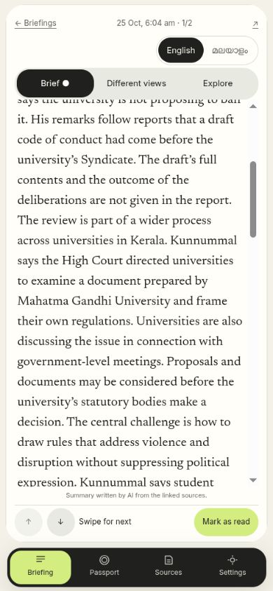
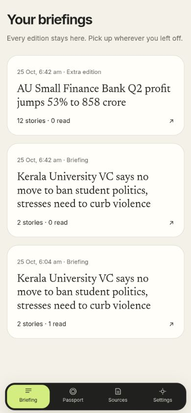
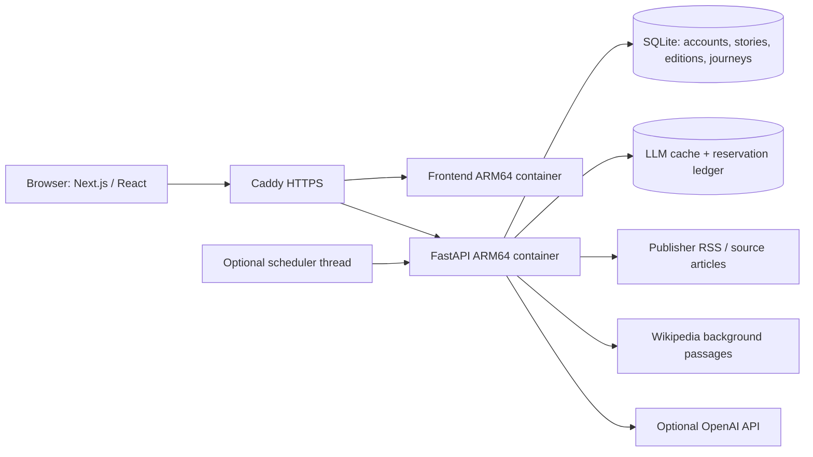

# Finite

**News that ends. Understanding that doesn't.**

[](https://github.com/akashanil-dev/Finite/actions/workflows/ci-cd.yml)

**[Open the live app](https://finite.akashanil.dev) · [Create an account](https://finite.akashanil.dev/signup) · [Sign in](https://finite.akashanil.dev/login) · [Evaluation guide](docs/EVALUATION.md) · [Architecture](docs/ARCHITECTURE.md)**

Finite is a working, account-based news application for readers who want to understand the news without an endless feed. It turns English and Malayalam coverage into a bounded, personalised briefing, then lets readers explore the context, different perspectives, history and connections behind a story. Each reading session and two-level exploration has an explicit ending. Saved editions remain available rather than disappearing when a newer edition arrives.

Built from scratch during **[Devin Hacks Kochi](https://www.devinhacks.in/), 24–25 October 2026**, by **Akash A ([akashanil-dev](https://github.com/akashanil-dev))**, with Devin and subsequent Codex assistance. [AI_USAGE.md](AI_USAGE.md) records actual contributions and validation; [RULES.md](RULES.md) records event requirements.

## Why Finite exists

News products make it easy to keep consuming headlines but harder to know when to stop or how to understand a story. Finite combines three product choices:

1. **A finite commitment:** a chosen number of stories, saved read progress, and an ending instead of automatic infinite loading.
2. **Understanding beyond the headline:** summaries at three depths, cited facts, gaps in the coverage, perspectives, chronology and bounded follow-up exploration.
3. **Visible evidence and limits:** publisher attribution, inspectable citations, explicit extractive fallbacks and empty states when support is insufficient.

The intended audience is readers seeking an India-first, English/Malayalam news briefing with context. Finite is a hackathon implementation, not an independently fact-checked news service. Its distinctive behavior is implemented in the application, not just described in this README.

## Try the production demo

The hosted app requires only a modern browser. **No local installation or API key is needed to try the hosted version.**

| Destination | Link | Access |
| --- | --- | --- |
| Product introduction | [finite.akashanil.dev](https://finite.akashanil.dev/) | Public |
| Create account | [Sign up](https://finite.akashanil.dev/signup) | Public; choose your own credentials |
| Existing account | [Log in](https://finite.akashanil.dev/login) | Public entry |
| Saved edition library | [Briefing](https://finite.akashanil.dev/briefing) | Sign-in required |
| Saved explorations | [Knowledge Passport](https://finite.akashanil.dev/passport) | Sign-in required |
| Publisher methodology | [Sources](https://finite.akashanil.dev/sources) | Sign-in required |
| Interests and delivery preferences | [Settings](https://finite.akashanil.dev/settings) | Sign-in required |
| Service health | [API health](https://finite.akashanil.dev/api/health) | Public JSON |
| Build and deployment history | [GitHub Actions](https://github.com/akashanil-dev/Finite/actions/workflows/ci-cd.yml) | Public |

Production runs as two ARM64 containers on Oracle Ampere behind Caddy HTTPS. AI has been activated with a separate **$15 cumulative application allowance** and a 100-request ceiling. This is shared installation capacity, not a per-user allowance or monthly billing subscription. When capacity is unavailable, supported features fall back to source excerpts. Production scheduling is enabled after explicit owner approval; its first ingestion completed successfully. A real clock-triggered edition has not yet been observed. [Activation evidence](deploy/SCHEDULER_APPROVAL.md) records that boundary.

### A five-minute walkthrough

1. Create an account, choose languages and interests, and set priority levels. Exclude topics or publishers if desired.
2. Open **Briefing**. Prepare your first edition if the library is empty, then open its card.
3. Read **Quick**, **Standard** or **Deep**. Open a citation to inspect the source. Mark a story read; progress belongs to your account.
4. Swipe vertically between news cards. Swipe horizontally, or use the visible tabs, to switch between **Brief**, **Different views** and **Explore**. Desktop users can use buttons and arrow keys.
5. In **Different views**, open Perspective Lens, Time Machine or Connection Explorer. For the knowledge map, select a branch and compare the evidence on both stories.
6. In **Explore**, choose a question or a Missing Piece. Follow a connection, optionally make a Curiosity Challenge prediction, and reach the second-level ending. Save the expedition to your Passport.
7. Return to **Briefing**: the original card remains. Each original/scheduled edition offers one **New edition** attempt. Once pressed, that action disappears; extra editions cannot create an unlimited refresh chain.

Coverage-dependent features may legitimately show one publisher, no meaningful connection, no dated passage, or insufficient background evidence. Those states are intentional; [the evaluation guide](docs/EVALUATION.md) explains what can be verified without relying on a particular changing headline.

## Mobile reading experience

The reader uses the screen for the article: edition date and position sit inside its card, and the headline scrolls with the body. Quick/Standard/Deep controls have room for their labels. A compact **56px fixed mobile dock** keeps navigation available without the former large footer. Longer content scrolls inside a panel; the next-story button also provides a direct way forward. Desktop uses a navigation rail.

| Compact reader | Saved edition library |
| --- | --- |
|  |  |

Screenshots are from the local production build against isolated copied news data, not staged illustrations or proof of physical-device testing. The underlying reporting remains attributed to its publishers. [Mobile QA](MOBILE_BRIEFING_QA.md) records viewport, persistence and interaction checks.

## Implemented features

| Feature | What the application does | Implementation / evidence |
| --- | --- | --- |
| Public landing page | Explains the product and offers separate signup/login entry points | [Homepage](frontend/src/app/page.tsx), [design QA](DESIGN_QA.md) |
| Accounts and sessions | Username/password registration, login, logout, revocable cookie sessions; account-owned profiles, briefings and journeys | [Auth backend](backend/app/auth.py), [auth tests](backend/tests/test_auth.py) |
| Curiosity profile | Weighted subject priorities, English/Malayalam preferences, source/topic exclusions, story count, lookback window, delivery time and timezone | [Profile editor](frontend/src/components/profile-editor.tsx), [taxonomy](backend/app/taxonomy.py) |
| News ingestion | Reads 29 configured publisher feeds; classifies articles and lazily extracts full text | [Ingestion](backend/app/ingest.py), [source registry](backend/app/sources.py) |
| Personalised briefing builder | Ranks by interest, source weight and freshness; groups similar coverage, limits topic concentration and skips previously delivered articles | [Builder](backend/app/briefing.py) |
| Saved edition library | Keeps multiple editions and earlier days, with pagination, dates and read counts | [Library UI](frontend/src/app/briefing/page.tsx), [history tests](backend/tests/test_briefing_history.py) |
| One-time extra edition | Atomic server-side claim; original retained, child cannot chain, empty attempts do not create empty cards | [API](backend/app/main.py), [history tests](backend/tests/test_briefing_history.py) |
| Scheduled preparation | Background ingestion and preparation 30 minutes before a local delivery time; unique user/date prevents duplicate scheduled editions, including midnight boundaries | [Scheduler](backend/app/main.py); unit-tested, real clock-triggered delivery verification remains separate |
| Swipe reader | Finite vertical story cards; horizontal Brief / Different views / Explore panels; buttons and keyboard alternatives; saved read progress and ending | [Deck](frontend/src/components/briefing-deck.tsx), [panels](frontend/src/components/swipe-panels.tsx) |
| Three reading depths | Quick, Standard and Deep summaries with cited facts and distinct publication/update metadata | [Analysis](backend/app/analysis.py), [reader](frontend/src/app/story/[id]/story-view.tsx) |
| The Missing Piece | Questions about what the retrieved coverage leaves unexplained | [Analysis](backend/app/analysis.py), [real-key audit](AI_UX_QA.md) |
| Rabbit holes | Source-backed contextual exploration capped at two levels; claim support checks, evidence gaps and explicit ending | [Exploration](backend/app/rabbithole.py), [retrieval](backend/app/retrieval.py) |
| Ask your own | Custom questions scoped to the story; unrelated questions rejected | [Exploration API](backend/app/main.py), [AI audit](AI_UX_QA.md) |
| Curiosity Challenges | Optional ungraded prediction before level two; cited reveal and reflection, saved with the journey | [Challenge UI](frontend/src/components/curiosity-challenge.tsx) |
| Perspective Lens | Up to eight distinct publishers, attributed excerpts and checked AI comparison claims; single-publisher and insufficient-evidence states | [Perspectives](backend/app/perspectives.py), [tests](backend/tests/test_perspectives.py) |
| Time Machine | Dated source quotations and a separate publication/update coverage history; unclear dates are not invented | [Timeline](backend/app/time_machine.py), [tests](backend/tests/test_time_machine.py) |
| Connection Explorer | Up to three related stored stories with shared-subject/headline relevance checks and evidence on both sides | [Connections](backend/app/connections.py), [regression tests](backend/tests/test_connections.py) |
| Interactive knowledge map | Select finite branches to inspect source evidence; switch to list view | [Map/list UI](frontend/src/components/connection-explorer.tsx) |
| Knowledge Passport | Saved journeys, explored concepts and challenge predictions; no streak mechanic | [Passport](frontend/src/app/passport/page.tsx) |
| Malayalam support | Malayalam feeds and cached AI translation; original content retained when translation cannot be supported | [Translation](backend/app/translate.py) |
| Source methodology | Outlet tiers, editorial confidence weights and rationales, visible with citations | [Sources page](frontend/src/app/sources/page.tsx), [registry](backend/app/sources.py) |
| Persistent AI guard | Atomic pre-request reservations, bounded model/output sizes, cache reuse, 100-call ceiling and extractive fallback | [Budget](backend/app/budget.py), [tests](backend/tests/test_budget.py) |
| Container delivery | Checks, ARM64 image build/smoke/publish and automatic SHA-based Oracle deployment on main | [Workflow](.github/workflows/ci-cd.yml), [deployment](deploy/README.md) |

## How AI is used—and constrained

AI is an optional part of the backend, not a requirement for account creation or all features.

1. RSS articles are classified and grouped into stories. With AI enabled, embeddings assist grouping; without it, keyword classification and TF-IDF similarity provide an approximate fallback.
2. Story analysis uses retrieved publisher passages to produce summaries, facts, questions and concepts. A separate support check evaluates summary assertions, factual claims and question premises. Rejected summaries become literal excerpts, and unsupported items are removed.
3. Rabbit holes retrieve story passages and Wikipedia background, write cited context, and check claims against the retrieved evidence. Gaps remain visible; the system does not invent follow-up questions just to fill a branch.
4. Perspective comparisons use distinct publishers and an explicit support check. Multiple syndicated or related pages are not automatically proof of independent corroboration.
5. Versioned/mode-aware caches reduce repeated calls and avoid retaining obsolete extractive analyses after AI activation.

| Mode | Available behavior |
| --- | --- |
| With an approved key and remaining allowance | AI classification/grouping, checked analysis and exploration, supported comparison claims, cached Malayalam translation |
| Without a key or when a request is blocked | Extractive summaries/context, source attribution, deterministic connections/map/timeline, accounts, saved editions and Passport; translation may be unavailable |

Default configured models are `gpt-6-luna`, `gpt-6.1-sol` and `text-embedding-3-small`. These names describe the implementation configuration, not a promise of model access for every developer account. Unknown model overrides are blocked by the allowance guard until their rates are reviewed.

**Grounding is not a factual guarantee.** Retrieval can miss context, sources can be wrong, and model verification can fail. No percentage accuracy or comprehensive editorial validation is claimed. [AI_UX_QA.md](AI_UX_QA.md) documents the real-key cases, fallbacks and limits.

### Spending controls

- `FINITE_AI_BUDGET_USD` defaults to **$1**, accepts **$0–$15**; this project uses separate development **$5** and approved production **$15** installations.
- `ai_budget.sqlite3` persists conservative reservations across restarts. It is neither actual billed usage nor a monthly reset.
- Every uncached call reserves capacity before contacting the provider. Failed calls retain reservations; there are no automatic SDK retries.
- A separate **100-request installation ceiling** can stop AI before the dollar allowance is exhausted.
- Cache hits require no reservation. Requests that cannot fit fall back where supported.
- Do not delete/reset the ledger to recover capacity. This guard does not cover other applications or guarantee an account-wide provider billing cap.

## Architecture at a glance



**Stack:** Python 3.13+, FastAPI, SQLite WAL, feedparser, trafilatura, NumPy/scikit-learn, OpenAI SDK; Next.js 16, React 19, TypeScript and Tailwind CSS 4. Production uses same-origin `/api` routing. The web manifest supports standalone display; offline reading is not implemented.

See [ARCHITECTURE.md](docs/ARCHITECTURE.md) for data ownership, ranking, API routes, persistence and deployment flow.

## Run locally

Use Python 3.13+, [uv](https://docs.astral.sh/uv/), Node.js **24** (matches CI), npm and network access to publisher feeds. Commands below start from the repository root.

```bash
git clone https://github.com/akashanil-dev/Finite.git
cd Finite
cp backend/.env.example backend/.env
```

For a no-spend local evaluation, leave `OPENAI_API_KEY` empty and set `FINITE_SCHEDULER_ENABLED=false` in `backend/.env`. Preparing the first briefing still fetches source feeds on demand. Do not put keys in browser code or commit `.env`.

Terminal 1:

```bash
cd backend
uv sync --frozen
uv run uvicorn app.main:app --host 127.0.0.1 --port 8000
```

Terminal 2, from the repository root:

```bash
cd frontend
npm ci
npm run dev -- -H 127.0.0.1 -p 3000
```

Open [localhost:3000](http://localhost:3000), register, complete onboarding and prepare an edition. A fresh checkout has no bundled user database or fake news dataset. Publisher availability and your interest choices determine whether stories can be prepared.

For LAN testing, bind both services to `0.0.0.0` and add the exact `http://<laptop-ip>:3000` to `FINITE_ALLOWED_ORIGINS`; the browser defaults to API port 8000 on the same hostname. `NEXT_PUBLIC_API_URL` can override that address. Production builds use `same-origin` and proxy `/api` through Caddy.

### Environment configuration

| Variable | Meaning |
| --- | --- |
| `OPENAI_API_KEY` | Backend-only optional key; empty means extractive mode |
| `FINITE_AI_BUDGET_USD` | Persistent installation allowance, default 1, maximum 15 |
| `FINITE_FAST_MODEL` / `FINITE_SMART_MODEL` / `FINITE_EMBED_MODEL` | Configured model names; overrides must also be approved in budget rates |
| `FINITE_ALLOWED_ORIGINS` | Comma-separated exact frontend origins for browser requests |
| `FINITE_SECURE_COOKIES` | `true` behind production HTTPS; `false` for local HTTP |
| `FINITE_SCHEDULER_ENABLED` | Start background scheduling; use `false` for controlled evaluation |
| `FINITE_INGEST_INTERVAL_MIN` | Scheduled ingestion interval, default 60 minutes |
| `FINITE_DATA_DIR` | Persistent directory, default `backend/data`; parent must exist |
| `NEXT_PUBLIC_API_URL` | Frontend build-time API location; `same-origin` in production |

Sanitized templates: [local](backend/.env.example), [production](deploy/backend.env.example).

### Checks matching CI

Run each subshell from the repository root:

```bash
(cd backend && uv sync --frozen && OPENAI_API_KEY='' FINITE_SCHEDULER_ENABLED=false uv run python -m unittest discover -s tests -v)
(cd backend && OPENAI_API_KEY='' FINITE_SCHEDULER_ENABLED=false uv run python -c 'import app.main')
(cd frontend && npm ci && npx next typegen && npx tsc --noEmit && npx eslint src --max-warnings=0 && npm run build)
bash -n deploy/deploy.sh deploy/ssh-dispatch.sh
```

Latest implementation checkpoint: **51 backend tests pass**, frontend TypeScript/ESLint/production build pass, and 320px/390px plus desktop browser checks pass. Automated tests do not make paid AI calls. Real-key sample checks and production browser evidence are recorded separately:

- [Mobile/history QA](MOBILE_BRIEFING_QA.md)
- [Real AI and exploration audit](AI_UX_QA.md)
- [Live account and feature QA](LIVE_QA.md)
- [Design and connection-regression QA](DESIGN_QA.md)

If a restricted environment prevents Turbopack from binding a local port, run the build with normal local-port permissions. Do not replace framework code to hide a sandbox restriction. Avoid rebuilding `.next` while serving that same production build.

## Accounts, privacy and persistence

Usernames are case-insensitive, 3–32 letters/numbers/underscores. Passwords are 8–128 characters without composition rules. Password reset and email verification are intentionally absent from this version.

Passwords use salted scrypt. Opaque session tokens are stored as hashes; cookies are HttpOnly, SameSite=Lax, and Secure in production, with a 30-day expiry. Logout revokes the session. Persistent username/IP attempt buckets throttle authentication. Browser writes require an allowed origin and `X-Finite-Request: 1`; administrative ingestion and budget inspection require an explicit admin role.

Profiles, briefing history/read progress and saved journeys are account-owned. News articles, source analysis and exploration caches are shared content. User questions can be sent to OpenAI when AI mode is enabled; do not enter secrets into exploration prompts. No claim of a full independent security audit is made.

State lives outside Git in `backend/data/` locally and `/opt/finite/data` on the server. Existing legacy data is never automatically assigned to the first account. See [architecture and administration](docs/ARCHITECTURE.md) for explicit migration/admin commands. Do not delete the database, WAL files or budget ledger as a troubleshooting shortcut.

## Deployment

[The CI/CD workflow](.github/workflows/ci-cd.yml) checks all branches/PRs without AI. Main builds and smoke-tests native ARM64 frontend/backend images, publishes full-commit-SHA tags to GHCR and deploys over restricted SSH when `FINITE_DEPLOY_ENABLED=true`.

The server **pulls images; it does not clone or build the repository**. Deployment code and Compose configuration are root-owned. Before changing containers, the deployment script makes integrity-checked SQLite online backups as the app user, avoiding WAL ownership failures. A failed update attempts to restore previous images; this is not an automatic database-schema rollback. Persistent data and budget reservations survive releases.

[Deployment guide](deploy/README.md) · [server handoff and approval boundary](deploy/SERVER_HANDOFF.md) · [Compose](deploy/compose.yml) · [deployment script](deploy/deploy.sh)

## Known limitations and next steps

- AI output is source-checked but not guaranteed correct. Broader editorial evaluation and human Malayalam review remain necessary.
- Some RSS/full-text sources block automated access. No paywall bypass or complete news/archive coverage is promised.
- Without AI, classification and grouping are approximate. One event can appear as more than one story.
- Connection matching is deliberately conservative: weak links are omitted, while synonyms, translations and body-only relationships can be missed. The graph is a bounded navigation view, not a comprehensive semantic knowledge base.
- Time Machine recognizes English date expressions in stored text. Coverage timestamps are not treated as event dates; it is not a complete historical archive.
- Source credibility weights are editorial methodology v0, not an objective truth score. Multi-outlet coverage does not necessarily mean independent reporting.
- Schedules require the server scheduler to be enabled, matching new stories and available resources. Unit-tested timing does not prove a real future delivery has occurred.
- An extra-edition attempt is consumed even if no new matching stories are available. A process crash during first-ever creation can leave a request claim requiring operator inspection.
- Mobile viewport checks passed; physical touch devices, Safari, full accessibility, load testing and disaster recovery drills remain open.
- No password recovery, email verification, offline article cache, push notifications or analytics dashboard is implemented.

## Data, dependencies and attribution

- [Publisher registry](backend/app/sources.py): RSS URLs, outlet names, tiers and rationales. Publisher content remains attributed and links to original reporting; it is not relicensed by this repository.
- [Wikipedia API](https://www.mediawiki.org/wiki/API:Main_page): background passages with source links; Wikipedia text is subject to its applicable attribution/share-alike terms.
- [Python dependency lock](backend/uv.lock) and [npm lock](frontend/package-lock.json): reproducible library versions. Libraries retain their respective licenses.
- Fonts: Inter, Newsreader and Noto Sans Malayalam. The [design references](DESIGN_QA.md) informed palette/composition; no Pinterest artwork was copied.
- AI-assisted development and product AI usage: [AI_USAGE.md](AI_USAGE.md).

## Repository guide

| Document | Purpose |
| --- | --- |
| [Evaluation guide](docs/EVALUATION.md) | Demo route, evidence matrix, expected fallbacks and limitations |
| [Architecture](docs/ARCHITECTURE.md) | Modules, data flow, APIs, ownership and operations |
| [Submission](SUBMISSION.md) | Ready-to-use project description, production/repository links and submission checklist |
| [Project context](PROJECT_CONTEXT.md) | Canonical detailed decisions, feature history, roadmap and handoff |
| [Changelog](CHANGELOG.md) | Timestamped implementation and validation record |
| [AI usage](AI_USAGE.md) | Devin/Codex contributions, human review and validation boundaries |
| [Agent guide](AGENTS.md) / [event rules](RULES.md) | Development workflow and event requirements |

This README describes implemented behavior and separately labels unverified or planned work. Final organizer submission and final freeze SHA are tracked in [SUBMISSION.md](SUBMISSION.md).
