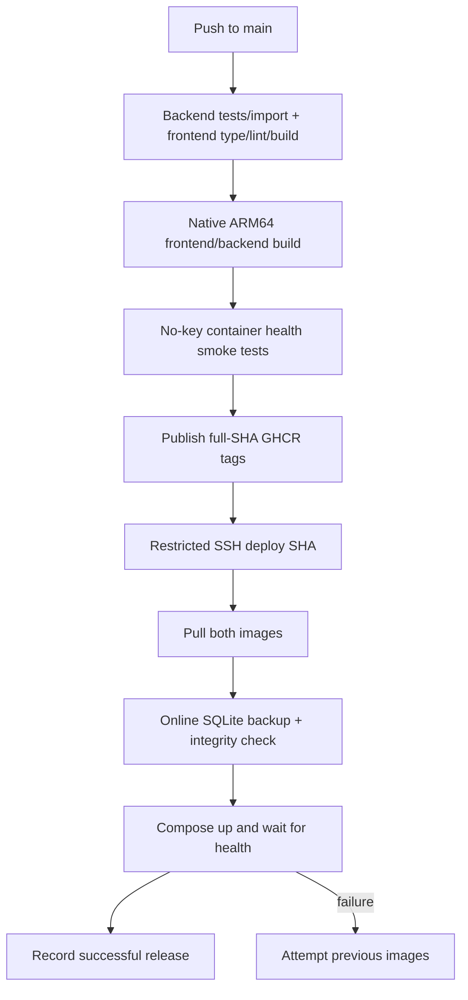

# Finite architecture and implementation map

This document describes the current code. [PROJECT_CONTEXT.md](../PROJECT_CONTEXT.md) retains the longer decision history; [README.md](../README.md) is the product/setup entry point.

## Components and responsibilities

| Component | Responsibility |
| --- | --- |
| `frontend/src/app` | Public landing/auth pages and protected briefing, story, Passport, Sources and Settings routes |
| `components/briefing-deck.tsx`, `swipe-panels.tsx` | Finite vertical card navigation and horizontal feature panels; visible/keyboard alternatives |
| `components/rabbit-hole.tsx` | Two-level journey, prediction, evidence display and save flow |
| `backend/app/main.py` | FastAPI routing, browser-write checks, background scheduler and analysis prefetch |
| `auth.py` | Accounts, password hashing, session lifecycle, authentication throttling and administrator dependency |
| `ingest.py`, `sources.py`, `taxonomy.py` | Feed ingestion, source registry, extraction and topic classification |
| `briefing.py` | Profile persistence, ranking/grouping, frozen editions, history and read progress |
| `analysis.py`, `perspectives.py` | Source-backed story analysis and multi-publisher comparison |
| `retrieval.py`, `rabbithole.py` | Background retrieval, bounded exploration and claim support checks |
| `connections.py`, `time_machine.py` | Deterministic related-story evidence and source-dated chronology |
| `translate.py` | Cached Malayalam translations tied to analysis mode/version |
| `llm.py`, `budget.py` | Cached model access, structured responses and persistent pre-request reservations |
| `db.py` | SQLite schema, additive migrations, WAL connections and transaction helpers |
| `deploy/` | ARM64 Compose runtime, restricted SSH entry point, backup/health/rollback procedure |

Paths above are relative to `backend/app/` unless another location is given. No external vector database, queue service, graph database or agent orchestration platform is required.

## From feed to saved edition

1. Ingestion reads configured RSS feeds and upserts publisher articles. Full text is fetched lazily; source access failures do not become fabricated articles.
2. Classification assigns subfield scores and a story type. The fallback uses keywords/source hints; AI classification is optional.
3. The builder selects articles inside the profile’s lookback window and allowed languages/sources/topics.
4. Interest priority, source weight and freshness determine relevance. The implemented score includes exponential age decay. Similarity groups coverage using embeddings when available or TF-IDF otherwise.
5. Previously delivered article IDs are considered when filtering clusters. Multi-source coverage affects ranking; a first-pass per-subfield cap encourages diversity, then deferred ranked eligible clusters fill any remaining slots (local correction, not yet deployed).
6. Selected story IDs and a profile snapshot are saved in an edition. Empty selections produce no edition. Existing story rows are reused rather than replaced.
7. A four-worker executor can prefetch analysis. Reading progress is saved separately on each owned edition.

The builder is a practical heuristic, not a learned recommendation model. Grouping errors and incomplete sources can affect the result.

## Edition lifecycle

- **First edition:** `POST /api/briefings` is permitted only while the account has no edition. A transactional claim prevents simultaneous first-creation requests.
- **Library:** `GET /api/briefings` returns 20 owner-scoped cards with a `before` cursor for older pages. All stored editions remain addressable by ID.
- **Extra:** `POST /api/briefings/{id}/edition` checks ownership and atomically sets `refresh_used` before ingestion. Only an original/scheduled edition may create an extra, identified by `edition_of`.
- **One attempt:** duplicate clicks, already-used originals and extra-to-extra chains are rejected. Failure/no new matching stories does not refund the attempt. The original edition remains untouched.
- **Scheduled:** when enabled, the scheduler checks every five minutes, ingests at its configured interval and prepares 30 minutes before local delivery time. A unique `(user_id, scheduled_for)` key prevents two saved scheduled editions for the same delivery date. Manual extras do not suppress the schedule; midnight preparation uses the upcoming delivery date.
- **Retention:** there is no automatic edition deletion or replacement routine. Backup/storage capacity still needs operational management.

The scheduler is a single-process daemon thread in the current deployment. It is not a distributed job scheduler or guaranteed push-notification service. A crash during first-creation can leave a claim requiring operator inspection; do not clear it without checking for a running request or saved edition.

## Data and account ownership

| Store | Data | Scope |
| --- | --- | --- |
| `users`, `sessions`, `auth_attempts` | Password hashes, session-token hashes, expiry and throttle buckets | Authentication |
| `kv` | Account profile keys and ingestion metadata | Account profile or application metadata |
| `articles`, `stories` | Publisher coverage, grouping, analysis and translations | Shared news content |
| `briefings` | Owner, frozen story IDs, creation/window metadata, profile snapshot, read IDs, completion and edition lineage | Per account |
| `briefing_requests` | In-flight first-edition claim | Per account |
| `explorations` | Cached source-backed exploration payloads | Shared content cache |
| `journeys` | Saved story/path/concepts and optional challenge information | Per account |
| `llm_cache/` | Cached model results | Installation |
| `ai_budget.sqlite3` | Conservative model-request reservations | Installation; separate from content DB |

The SQLite content database uses WAL. The schema migrates additively at startup. Legacy unowned content/history is retained; it is not automatically given to a newly registered account. Keeping copies of private production databases in Git is prohibited.

## API map

All paths are prefixed with `/api`. Browser writes require `X-Finite-Request: 1`; allowed-origin checks also apply. The public health and register/login paths are exceptions to the sign-in dependency. The table describes the application API, not generated framework documentation routes.

| Method and path | Purpose | Access |
| --- | --- | --- |
| `GET /health` | Database-backed health | Public |
| `POST /auth/register`, `/auth/login` | Create account or session | Public, throttled |
| `GET /auth/me`, `POST /auth/logout` | Current identity / revoke session | Signed in |
| `GET /meta` | Taxonomy, languages, reading depths, runtime mode and delivery-time choices | Signed in |
| `GET /sources` | Registry and methodology | Signed in |
| `GET /profile`, `PUT /profile` | Read/update own preferences | Signed in |
| `GET /briefings` | Paginated saved edition cards | Owner-scoped |
| `POST /briefings` | First-ever edition only | Signed in |
| `GET /briefings/latest`, `/briefings/{id}` | Read saved edition | Owner-scoped |
| `POST /briefings/{id}/edition` | Consume the original’s one extra attempt | Owner-scoped |
| `POST /briefings/{id}/read` | Mark an included story read | Owner-scoped |
| `GET /stories/{id}` | Story analysis, optional supported language | Signed in |
| `GET /stories/{id}/perspectives` | Publisher comparison | Signed in |
| `GET /stories/{id}/timeline` | Source dates and coverage history | Signed in |
| `GET /stories/{id}/connections` | Related stories and evidence | Signed in; respects profile exclusions |
| `POST /stories/{id}/explore` | Bounded question/path exploration | Signed in |
| `POST /journeys`, `GET /passport` | Save/read own explorations | Owner-scoped |
| `POST /ingest`, `GET /ai-budget` | Operational ingestion / reservation status | Administrator |

Authoritative request/response definitions are in [main.py](../backend/app/main.py), [auth.py](../backend/app/auth.py) and [frontend API types](../frontend/src/lib/api.ts). API failures use explicit HTTP errors; lack of source evidence is also represented in feature payloads/UI.

## AI, retrieval and failure behavior

Retrieval combines the story’s own publisher passages with relevant Wikipedia background. The application uses contextual generation plus support checking; it does not fine-tune a model or maintain a general-purpose semantic knowledge graph.

Analysis validates assertions and question premises against retrieved passages. Rabbit-hole claim nodes need explicit positive support; unsupported nodes and dated events are removed. Comparisons use publisher attribution and fall back to excerpts when verification fails. Translation failures retain original content rather than returning an invented translation.

A source-backed answer can still be incomplete or incorrect. Model verification is a second model judgment, not independent editorial proof. Prompt/context caches are versioned where behavior depends on analysis version, mode, language or exploration depth. User-supplied questions may be processed by the configured provider.

Before every uncached model call, `budget.reserve()` uses a SQLite transaction to reserve a conservative input/output cost. Unknown rates, oversized requests, insufficient allowance and the 100-request ceiling block new calls. Reservations remain after failures and restarts. Cache hits do not reserve again. See [README spending controls](../README.md#spending-controls).

## Frontend routing and interaction

- `/` is public; `/signup` and `/login` have separate entry forms. `/start` chooses onboarding or the briefing library after authentication.
- `/briefing` is an edition library, not an infinitely refreshing latest-feed route.
- `/briefing/[id]` opens one saved finite deck. `/story/[id]` provides a full-page reader.
- Horizontal panels expose Brief, Different views and Explore. Long content scrolls within the active panel. The headline scrolls with the body to free mobile space.
- The compact mobile dock remains fixed. Desktop uses a rail; depth buttons wrap rather than clipping labels.
- Native scroll snapping supplies gestures. Resize observation realigns the selected horizontal panel after viewport changes. Buttons and keyboard controls provide alternatives.
- Next.js 16 Cache Components are enabled. Dynamic URL hooks sit inside Suspense boundaries. Most personalized data is fetched through the authenticated client API rather than cached as public server output.
- A web manifest supplies standalone display metadata; no service-worker offline news cache is implemented.

## Build, deploy, backup and rollback



The workflow serializes production deployments. The server has no Git checkout/build requirement. A forced-command SSH dispatcher accepts a release SHA, not an arbitrary shell. Root-owned deployment code and Compose configuration are separate from writable persistent data. Secrets remain in GitHub Actions or the server environment, not image layers or frontend bundles.

Backups run through the existing backend as the application UID so host deployment operations do not create unwritable WAL/SHM sidecars. Both the content DB and existing budget ledger are backed up with bounded timeouts and integrity checks. Images are pulled before changing the running release.

Rollback restores previous **images**, not database schema/data. Additive migrations make the current change safer, but future incompatible migrations require a specific recovery plan. A first deployment has no prior image release. See [deploy.sh](../deploy/deploy.sh) and [deployment guide](../deploy/README.md) for actual behavior.

## Administration

From `backend/`, after backing up and explicitly choosing the account:

```bash
uv run python -m app.manage_user YOUR_USERNAME --admin
uv run python -m app.manage_user YOUR_USERNAME --revoke-admin
uv run python -m app.claim_legacy YOUR_USERNAME
```

Registration never grants administrator access. Legacy claiming is an explicit local operation and does not overwrite an already saved account profile. Do not execute migration or server configuration changes merely to make a demo look populated.

Production infrastructure changes require the owner’s explicit approval under the [server handoff](../deploy/SERVER_HANDOFF.md). Routine main-branch CI/CD deployments are already authorized; changing AI/scheduling configuration is a separate batch.
